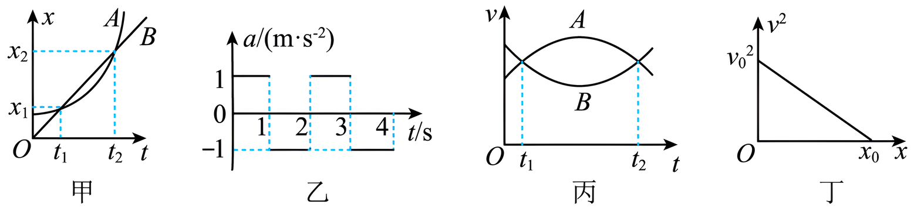

# Physics - 题目 1335

**ID**: 942075c6c9624a5095e22ce8c58a0ef8
**年级**: Grade 10
**难度**: Medium
**题型**: Multiple-select

## 题目
下面图像描述的是物体做直线运动的相关图像。​​​​​​​‌关于甲、乙、丙、丁四个图像，下列说法正确的是（      ）

## 解答

1. A．甲图中在 $t{{}_{1}}\sim t{{}_{2}}$ 时间内，A和B的位移相等，平均速度是指物体发生的位移与所用时间的比值，所以A的平均速度等于 ${\rm B}$ 的平均速度，故A正确；
2. B．乙图表示物体先匀加速，后匀减速，加速减速的时间相等，加速度大小相等，所以物体一直朝一个方向运动，故B错误；
3. C．v-t图线的交点表示物体速度相等，由于不知道出发点，所以无法确定A和B是否在 $t{{}_{1}}$ 、 $t{{}_{2}}$ 两个时刻相遇，故C错误；
4. D．根据匀变速直线运动的速度位移关系，有
5. $v{^{2}}-v{{}_{0}}{^{2}}=2ax$
6. 所以图线的斜率为2a，斜率不变，即加速度 $a$ 不变，由图可见速度减少，所以丁图中物体做匀减速直线运动，故D正确。
7. 故选AD。

## 知识点

**中文**:
  - 非常规图像问题

**English**:
  - Non-standard Graph Problems

---
