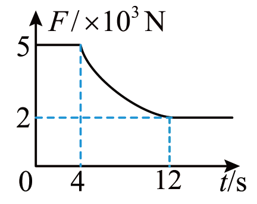

# Physics - 题目 2047

**ID**: 9959c28ca94f45d2b219d0c51e04fe6b
**年级**: Grade 10
**难度**: Medium
**题型**: Multiple-select

## 题目
一辆汽车由静止开始沿平直公路行驶，汽车所受牵引力 $F$ 随时间 $t$ 变化如图所示。​​​​​​​‌若汽车的质量为 $1.5\times 10{^{3}}{\rm{k}}{\rm{g}}$ ，阻力恒定，汽车的最大功率恒定，则以下说法正确的是（      ）

## 解答

1. 由图可知，汽车在前4s内的牵引力不变，汽车做匀加速直线运动，4~12s内汽车的牵引力逐渐减小，则车的加速度逐渐减小，汽车做加速度减小的加速运动，直到车的速度达到最大值，以后做匀速直线运动，可知在4s末汽车的功率达到最大值；汽车的速度达到最大值后牵引力等于阻力，所以阻力 $f=2\times 10{^{3}}{\rm{N}}$ ，前4s内汽车的牵引力为 $F=5\times 10{^{3}}{\rm{N}}$ ，由牛顿第二定律，有 $F-f=ma$ ，可得汽车匀加速运动阶段的加速度大小为 $a=2{\rm m}/{\rm s}{^{2}}$ ，故AB错误，C正确；由图可知，汽车在前4s内的牵引力不变，汽车做匀加速直线运动，根据P=Fv，可知汽车的功率不断的在增大，4~12s内汽车的牵引力逐渐减小，汽车做加速度减小的加速运动，直到车的速度达到最大值，以后做匀速直线运动，可知在4s末汽车的功率达到最大值，以后保持不变，故D正确。

## 知识点

**中文**:
  - 机车启动的两种方式

**English**:
  - Two Modes of Locomotive Start-up

---
