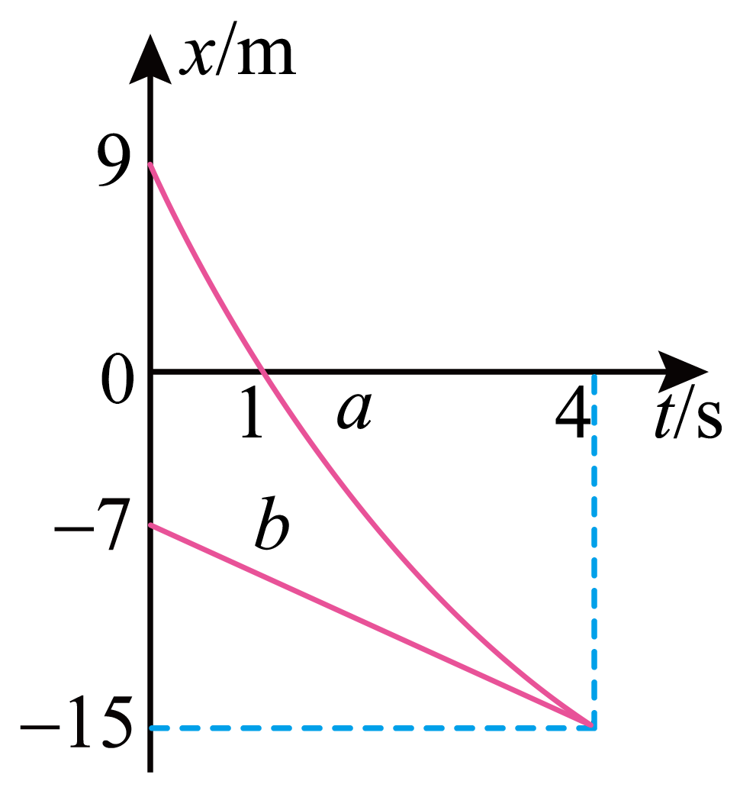

# Physics - 题目 669

**ID**: ab8691d674604e6d8130bb5bba0ca203
**年级**: Grade 10
**难度**: Medium
**题型**: Multiple-select

## 题目
甲、乙两个物体在同一直线上运动，其x—t图像如图所示。​​​​​​​‌已知直线b与曲线a相切于点（4，-15），且知甲做匀变速直线运动，下列说法正确的是（      ）

## 解答

1. A．前4s内两物体运动方向都沿 $-x$ 方向，方向相同。A正确；
2. B．前 ${{4}}{\rm{s}}{\rm s}$ 内甲的平均速度为
3. $v{{}_{1}}=\frac {(-15{\rm{m}})-9{\rm{m}}}{4{\rm{s}}}=-6{\rm{m}}{\rm{/}}{\rm{s}}$
4. 前 ${{4}}{\rm{s}}$ 乙的平均速度为
5. $v{{}_{2}}=\frac {(-15{\rm{m}})-(-7{\rm{m}})}{4{\rm{s}}}=-2{\rm{m}}{\rm{/}}{\rm{s}}$
6. 前4s内甲的平均速度是乙的平均速度的3倍。B错误；
7. C D． $t=1{\rm{s}}$ 末，甲的位移大小为 $9{\rm{m}}$ ， $t=4{\rm{s}}$ 末，甲的位移大小为 $24{\rm{m}}$ ，设甲的加速度大小 $a$ ，甲的初速度大小为 $v{{}_{0}}$ ，根据匀变速运动位移公式 $x=v{{}_{0}}t+\frac {1}{2}at{^{2}}$ 可得
8. $9=v{{}_{0}}+\frac {1}{2}a$
9. $24=4v{{}_{0}}+\frac {1}{2}a\cdot 4{^{2}}$
10. 解得
11. $a=-2{\rm{m}}{\rm{/}}{\rm{s}}{^{2}}$
12. $v{{}_{0}}=10{\rm{m}}{\rm{/}}{\rm{s}}$
13. 甲的加速度大小为2 m/s^{2}，t=0时刻，甲的速度大小为 $10{\rm{m}}{\rm{/}}{\rm{s}}$ 。
14. 选项C正确，D错误。
15. 选AC。

## 知识点

**中文**:
  - x-t图像及其应用

**English**:
  - x-t Graphs and Applications

---
