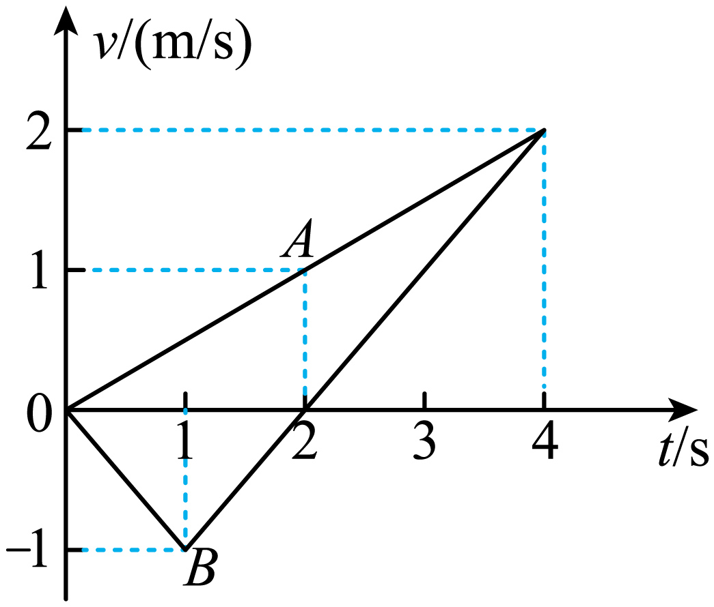

# Physics - 题目 2842

**ID**: ad86f8a18d4d408199c42cb4d030260c
**年级**: Grade 10
**难度**: Medium
**题型**: Multiple-select

## 题目
在如图所示的 $v-t$ 图中，A、B两质点同时从同一点在一条直线上开始运动，运动规律用A、B两图线表示，下列叙述正确的是（      ）​​​​​​​‌

## 解答

1. 由题图可知，t=1s时，B质点运动方向未发生改变，t=2s时，B质点运动方向发生改变，A错误；根据 $v-t$ 图像的斜率表示加速度，由题图可知，t=2s时，A质点的加速度大小为 $a{{}_{{\rm{A}}}}=\frac {1}{2}{\rm{m}}/{\rm{s}}{^{2}}{\rm ，B}$ 质点的加速度大小为 $a{{}_{{\rm{B}}}}=\frac {2}{4-2}{\rm{m}}/{\rm{s}}{^{2}}=1{\rm{m}}/{\rm{s}}{^{2}}$ ，则有 $a{{}_{{\rm{A}}}}:a{{}_{{\rm{B}}}}=1:2{\rm ，B}$ 正确；由题图可知，在t=4s时，A、B速度相同，此时A、B相距最远；根据 $v-t$ 图像与横轴围成的面积表示位移，可知 $0\sim 4{\rm{s}}$ 内A质点的位移为 $x{{}_{{\rm{A}}}}=\frac {1}{2}\times 2\times 4{\rm{m}}=4{\rm{m}}{\rm ，B}$ 质点的位移为 $x{{}_{{\rm{B}}}}=-\frac {1}{2}\times 1\times 2{\rm{m}}+\frac {1}{2}\times 2\times 2{\rm{m}}=1{\rm{m}}$ ，则A、B相距最远为 $\Delta x=x{{}_{{\rm{A}}}}-x{{}_{{\rm{B}}}}=3{\rm{m}}{\rm ，C}$ 正确，D错误。

## 知识点

**中文**:
  - 匀变速直线运动的v-t图像
  - 追及与相遇问题

**English**:
  - v-t Graphs of UVRM
  - Chase and Encounter Problems

---
