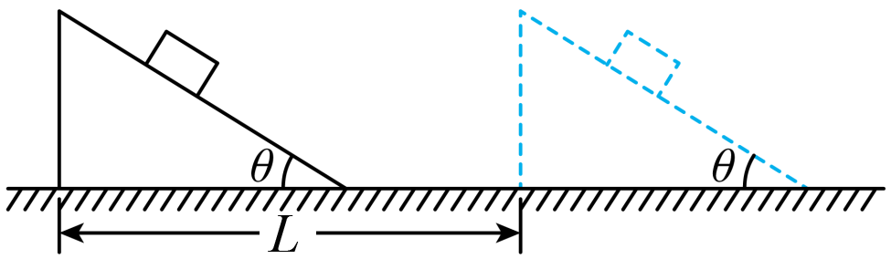

# Physics - 题目 392

**ID**: b7a422d3adf748288406109c90f62f1b
**年级**: Grade 10
**难度**: Medium
**题型**: Multiple-select

## 题目
质量为m的物体，静止在倾角为θ的斜面上，斜面沿水平方向向右匀速移动了距离L，如图所示。​​​​​​​‌物体相对斜面静止，则下列说法正确的是（      ）

## 解答

1. 物体的受力和位移方向如图所示。
2. 
3. 重力与位移垂直，重力不做功。A错误；B正确；摩擦力F_{f}与位移L的夹角大于90°，摩擦力做负功。C正确；支持力F_{N}与位移L的夹角α<90°，支持力做正功。D正确。

## 知识点

**中文**:
  - 功和功率

**English**:
  - Work and Power

---
