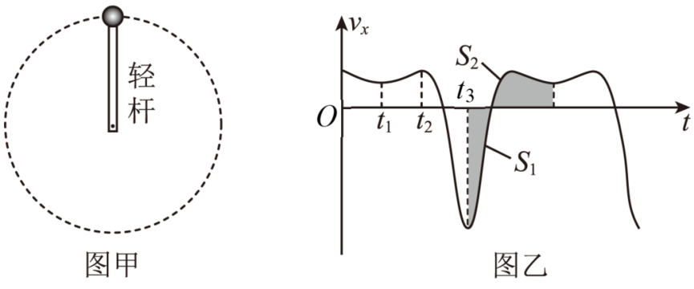

# Physics - 题目 2046

**ID**: c8bd5437840f4b13a4e2a0391edd0258
**年级**: Grade 10
**难度**: Medium
**题型**: Multiple-select

## 题目
如图甲所示，轻杆一端与一小球相连，另一端连在光滑固定轴上，可在竖直平面内自由转动。​​​​​​​‌现使小球在竖直平面内做圆周运动，到达某一位置开始计时，取水平向右为正方向，小球的水平分速度v_{x}随时间t的变化关系如图乙所示。不计空气阻力。下列说法中正确的是（      ）

## 解答

1. 由图知，在t_{3}时刻小球水平速度最大，所以t_{3}时刻小球经过最低点，此时水平速度为负，表示小球经过最低点时速度方向水平向左，所以小球在竖直平面内沿顺时针方向转动，A正确；小球在竖直平面内自由转动，只有重力做功，机械能守恒，B错误；小球经过最高点时水平分速度为正，且过最高点的前后两个时刻水平分速度相等，所以t_{1}时刻小球通过最高点，t_{1}时刻轻杆对小球可能没有弹力作用，t_{3}时刻在最低点，轻杆对小球一定有弹力作用，C错误；由小球的运动情况可知，S_{1}和S_{2}的面积等于杆长且相等，D正确。

## 知识点

**中文**:
  - 球杆模型圆周运动中机械能守恒定律的应用

**English**:
  - Rod-Ball Circular Motion Models

---
