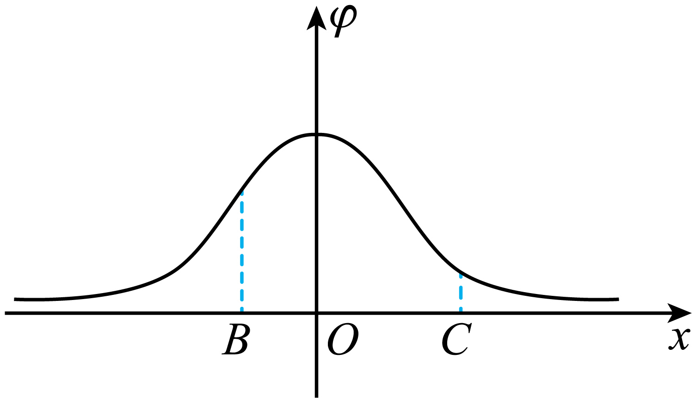

# Physics - 题目 902

**ID**: cd33264eae2340e6a6e5e254bbad8090
**年级**: Grade 10
**难度**: Medium
**题型**: Multiple-select

## 题目
某一沿x轴方向的静电场，其电势 $φ$ 在x轴上的分布情况如图所示，B、C是x轴上两点。​​​​​​​‌下列说法正确的是（      ）

## 解答

1. 根据 $φ-x$ 图像的切线斜率表示电场强度，可知在x轴上，O点电势最高，电场强度为0，最小，A错误；根据 $φ-x$ 图像的切线斜率绝对值表示电场强度大小，可知B点场强大于C点场强，则同一个电荷放在B点受到的电场力大于放在C点时的电场力，B错误；由题图可知，B点电势高于C点电势，根据 $E{{}_{{\rm{p}}}}=qφ$ 可知，同一个负电荷放在B点时的电势能小于放在C点时的电势能，C正确；沿x轴从B移到C的过程中，电势先升高后降低，根据 $E{{}_{{\rm{p}}}}=qφ$ 可知，正试探电荷沿x轴从B移到C的过程中，电势能先增大后减小，D正确。

## 知识点

**中文**:
  - 电势能与静电力做功
  - 静电场中的图像问题

**English**:
  - Electric Potential Energy and Work Done by Electrostatic Force
  - Graph Problems in Electrostatic Fields

---
