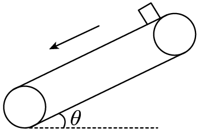

# Physics - 题目 2533

**ID**: f1e6ad04c18d44c2b16af615635f5ef2
**年级**: Grade 10
**难度**: Medium
**题型**: Multiple-select

## 题目
如图所示，倾角为的足够长倾斜传送带沿逆时针方向以恒定速率运行，一个小物块无初速度的放在传送带上端，传送带与物块间动摩擦因数 $μ<{\tan}θ$ ，取传送带底端为零势能面，下列描述小物块速度v，重力势能E_{P}，动能E_{k}和机械能E四个物理量随物块沿传送带运动距离x的变化趋势中正确的有（      ）​​​​​​​‌

## 解答

1. A．小物块无初速度的放在传送带上，先向下加速，最初阶段传送带的速度大于小物体的速度，滑动摩擦力沿传送带向下，根据牛顿第二定律的小物体的加速度 $a{{}_{1}}=g({\sin}θ+μ{\cos}θ)$ ，由 $v{^{2}}=2a{{}_{1}}x$ ，得 $v=\sqrt {2a{{}_{1}}x}$ ，v—x图像应为向x轴弯曲的一段曲线；
2. 当小物体加速到与传送带的速度相等后，由于 $μ<{\tan}θ$ ，重力沿斜面向下的分力大于滑动摩擦力，小物体受到的合力沿传送带向下，小物块继续向下加速；小物块的速度大于传送带的速度v_{0}后，摩擦力沿传送带向上，加速度 $a{{}_{2}}=g({\sin}θ-μ{\cos}θ)$ ，由 $v{^{2}}-v{{}_{0}^{2}}=2a{{}_{2}}x$ ，解得 $v=\sqrt {v{{}_{0}^{2}}+2a{{}_{2}}x}$ ，v-x图像同样为向x轴弯曲的一段曲线，A错误；
3. B．取传送带底端为零势能面，设初状态重力势能为E_{P}_{0}，重力势能表达式为 $E{{}_{{\rm{p}}}}=E{{}_{{\rm{p}}{{0}}}}-mgx{\sin}θ$E_{P}-x图像应为斜率为负值的一段直线，B正确；
4. C．小物块加速度为a_{1}时，根据动能定理有动能的表达式为 $E{{}_{{\rm{k}}}}=F{{}_{合}}x=ma{{}_{1}}\cdot x$ ，设此过程获得的动能为E_{k}_{0}，E_{k}-x图像应为斜率为正值、过原点的一段直线；小物块的速度大于传送带速度后加速度为a_{2}，动能表达式为 $E{{}_{{\rm{k}}}}=E{{}_{{\rm{k}}{{0}}}}+F{{}_{合}}x=E{{}_{{\rm{k}}{{0}}}}+ma{{}_{2}}x$ ，E_{k}-x图像应为斜率为正值的一段直线；由于 $a{{}_{1}}>a{{}_{2}}$ ，斜率变小，C正确。
5. D．小物块加速度为a_{1}时，摩擦力做正功，机械能增加，机械能表达式为 $E=E{{}_{{\rm{p}}{{0}}}}+{\rm μm}g{\cos}θ\cdot x$E-x图像应为斜率为正值的一段直线，纵轴截距为初状态的机械能E_{P}_{0}；小物体加速到与传送带的速度相等时，机械能增加到最大值E_{m}，小物块的速度大于传送带速度后，摩擦力做负功，机械能表达式为 $E=E{{}_{{\rm{m}}}}-{\rm μm}g{\cos}θ\cdot x$E-x图像应为斜率为负值的一段直线，D正确。选BCD。

## 知识点

**中文**:
  - 传送带模型中的能量守恒问题

**English**:
  - Energy Conservation in Conveyor Belt Models

---
