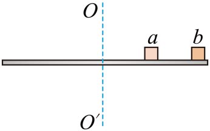

# Physics - 题目 447

**ID**: f3643a84835c4c819e629987ae2f5f94
**年级**: Grade 10
**难度**: Medium
**题型**: Multiple-select

## 题目
如图所示，两个质量均为 $m$ 的小木块 $a$ 和 $b$ （均可视为质点）放在水平圆盘上， $a$ 与转轴 $OO^{′}$ 的距离为 $l$ ， $b$ 与转轴的距离为 $2l$ ，两木块与圆盘的最大静摩擦力均为木块所受重力的 $k$ 倍，重力加速度大小为 $g$ 。​​​​​​​‌若圆盘从静止开始绕转轴缓慢地加速转动，用 $ω$ 表示圆盘转动的角速度，认为最大静摩擦力等于滑动摩擦力，下列说法正确的是（      ）

## 解答

1. 当a恰好发生滑动时，最大静摩擦力提供向心力 $kmg=mω{{}_{1}^{2}}l$ 解得 $ω{{}_{1}}=\sqrt {\frac {kg}{l}}$ ，当b恰好发生滑动时，最大静摩擦力提供向心力 $kmg=mω{{}_{2}^{2}}2l$ 解得 $ω{{}_{2}}=\sqrt {\frac {kg}{2l}}$ ，由上可知，b恰好发生相对滑动时的角速度更小，即b先发生滑动，AC正确；当角速度为 $ω<ω{{}_{2}}=\sqrt {\frac {kg}{2l}}$ 时，a，b均未发生相对滑动，静摩擦力提供向心力 $f{{}_{1}}=mω{^{2}}l$ ， $f{{}_{2}}=mω{^{2}}2l$ 此时，a，b所受摩擦力不同，B错误；当 $ω=\sqrt {\frac {3kg}{4l}}<\sqrt {\frac {kg}{l}}$ 时，a尚未发生滑动，所受摩擦力的大小为 $f^{′}{{{}_{1}}}=mω{^{2}}l=\frac {3}{4}kmg{\rm D}$ 错误。选AC。

## 知识点

**中文**:
  - 水平面内匀速圆周问题

**English**:
  - Uniform Circular Motion in Horizontal Plane

---
