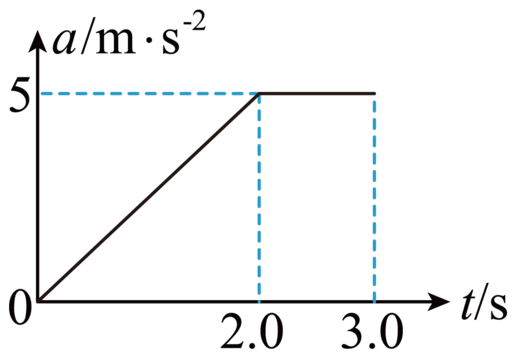

# Physics - 题目 1073

**ID**: f3a09669869945f5a93814b45b7af969
**年级**: Grade 10
**难度**: Medium
**题型**: Multiple-select

## 题目
“加速度的变化率”可以表示加速度随时间变化的快慢，汽车加速度的变化率越小，乘客舒适感越好。​​​​​​​‌某轿车由静止启动，前3s内加速度随时间的变化关系如图所示，则（      ）

## 解答

1. 由图像可知，2s~3s内轿车加速度不变，轿车做匀加速直线运动，故A正确；根据加速度定义式 $a=\frac {Δv}{Δt}$ 可知，加速度随时间的变化关系的图像面积表示速度的变化量，所以0~3s内轿车的速度变化量为 $\Delta v=\frac {1}{2}\times (1+3)\times 5{\rm{m}}{\rm{/}}{\rm{s}}=10{\rm{m}}{\rm{/}}{\rm{s}}$ ，由于轿车由静止启动，所以第3s末，轿车速度达到10m/s，故B正确；由题意可知，加速度变化率为 $\frac {Δa}{Δt}$ ， $\Delta a$ 的单位为m/ ${\rm s^{2}，}Δt$ 的单位为s，所以加速度变化率的单位为m/s^{3}，故C错误；由图像可知，0~2s内的加速度变化率为 $\frac {\Delta a}{\Delta t}=\frac {5}{2}{\rm{m}}{\rm{/}}{\rm{s}}{^{3}}$ ，而2s~3s内的加速度变化率为零。汽车加速度的变化率越小，乘客舒适感越好，所以乘客感觉2s~3s内更舒适，故D错误。

## 知识点

**中文**:
  - 认识a-t图像

**English**:
  - Understanding a-t Graphs

---
