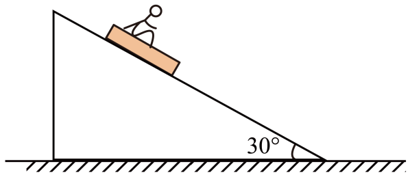

# Physics - 题目 1218

**ID**: f6abd93b43ee425ca9c779c50e05d452
**年级**: Grade 10
**难度**: Medium
**题型**: Multiple-select

## 题目
彩虹滑道是一款旱地仿滑雪设备，其模型如图所示。​​​​​​​‌质量为50 kg的人坐在滑板上，从滑道斜面顶端由静止开始沿直线匀加速下滑，经过5 s到达底端，速度大小为20 m/s。已知彩虹滑道的倾角为30°，重力加速度 $g=10{\rm{\;}}{\rm{m}}/{\rm{s}}{^{2}}$ ，该过程中下列说法正确的是（      ）

## 解答

1. A．人下滑的位移 $x=\frac {v}{2}t=\frac {20}{2}\times 5{\rm{\;}}{\rm m}=50{\rm{\;}}{\rm m}$ ，人下滑的高度 $h=x\sin 30{}\degree =25{\rm{\;}}{\rm m}$ ，
2. 人的重力势能的减少量 $\Delta E{{}_{{\rm p}}}=mgh=50\times 10\times 25{\rm{\;}}{\rm{J}}=1.25\times 10{^{4}}{\rm{\;}}{\rm{J}}{\rm ，A}$ 错误；
3. C．人的动能增加量 ${\rm{Δ}}E{{}_{{\rm{k}}}}=\frac {1}{2}mv{^{2}}=\frac {1}{2}\times 50\times 20{^{2}}{\rm{\;}}{\rm{J}}=1\times 10{^{4}}{\rm{\;}}{\rm{J}}{\rm ，C}$ 正确；
4. B．人下滑过程，由动能定理得 $mgh-W{{}_{f}}=\frac {1}{2}mv{^{2}}-0$ ，解得人克服阻力做功 $W{{}_{f}}=2.5\times 10{^{3}}{\rm{\;}}{\rm{J}}$ ，
5. B正确；
6. D．机械能的减少量等于克服阻力做的功，由功能关系可知，人机械能的减少量
7. $\Delta E=W{{}_{f}}=2.5\times 10{^{3}}{\rm{\;}}{\rm{J}}{\rm ，D}$ 错误。选BC。

## 知识点

**中文**:
  - 应用动能定理求解变力做功问题

**English**:
  - Solving Work Done by Variable Force

---
