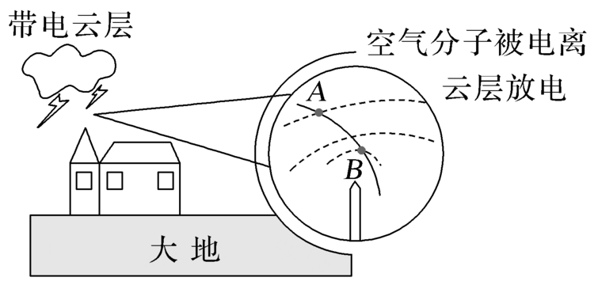

# Physics - 题目 2487

**ID**: e3b8414260f0476c9e205d4570e17ffd
**年级**: Grade 10
**难度**: Medium
**题型**: 达标练

## 题目
如图所示，某次雷雨天气，带电云层和建筑物上的避雷针之间形成电场，图中虚线为该电场的三条等差等势面，实线为某带电粒子从A运动到B的轨迹，A、B为运动轨迹上的两点。​​​​​​​‌带电粒子的重力不计，避雷针带负电。则（      ）

## 解答

1. 根据带电粒子的运动轨迹可知，带电粒子受到指向曲线内侧的作用力，即带电粒子与带负电的避雷针之间为相互吸引力，带电粒子带正电，A错误；避雷针带负电，带电云层和建筑物上的避雷针之间形成的电场中，电场线指向避雷针，沿着电场线的方向，电势降低，由此可知，避雷针尖端附近电势较低，B错误；等差等势面越密集的位置，电场强度越强，由此可知，B点的电场强度大小大于A点的，由牛顿第二定律 ${\rm \mathit{a}＝}\frac{qE}{m}$ ，可知带电粒子在B点的加速度大于在A点的加速度，C错误；避雷针尖端附近电势较低，即φ_{A}＞φ_{B}，根据电势能与电势的关系E_{p}＝qφ，又因为粒子带正电，则带电粒子在A点的电势能大于在B点的电势能，D正确。

## 知识点

**中文**:
  - 电势能与静电力做功

**English**:
  - Electric Potential Energy and Work Done by Electrostatic Force

---
