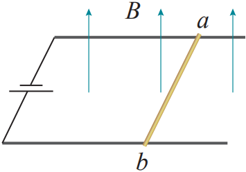

# Physics - 题目 2598

**ID**: 27353e0ab4ca4d56aa716db0ccfd91f8
**年级**: Grade 11
**难度**: Easy
**题型**: Calculation

## 题目
如图，已知电源的电动势为E，内阻为r，金属杆ab放在平行金属导轨上保持静止。​​​​​​​‌已知ab在金属导轨之间的长度为l、电阻为R，整个装置处在竖直向上的匀强磁场中，磁感应强度为B。ab杆受到磁场的安培力作用，就是ab杆中的自由电子定向运动时受到的洛伦兹力的合力。已知ab杆的横截面积为S，杆中单位体积的自由电子个数为n，求：（1）ab杆所受到的安培力F的大小和方向；（2）ab杆中每个自由电子受到的洛伦兹力f的大小。

## 解答

1. （1）由闭合电路欧姆定律有 $I=\frac {E}{R+r}$
2. 可知安培力 $F=IlB=\frac {ElB}{R+r}$
3. 左手定则可知安培力方向水平向右。
4. （2）设ab杆中共有N个定向移动的自由电子，则 $F=Nf$
5. 又 $N=nSl$
6. 解得 $f=\frac {EB}{nS(R+r)}$

## 知识点

**中文**:
  - 安培力作用下的运动问题
  - 闭合电路的欧姆定律及其应用

**English**:
  - Motion under Ampere Force
  - Ohm's Law for Closed Circuits and Applications

---
