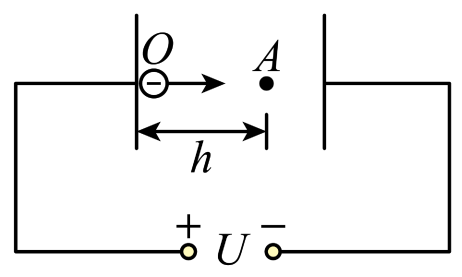

# Physics - 题目 77

**ID**: b16272c523df4771968a1ea2b59ab9a5
**年级**: Grade 11
**难度**: Easy
**题型**: Calculation

## 题目
如图，两平行金属板相距为d，电势差为U，一个电子从O点沿垂真于极板的方向射出，最远到达A点，然后返回。​​​​​​​‌已知OA两点相距为h，电子质量为m，电子的电荷量为e，试计算。（1）OA的电势差U_{OA}；（2）此电子在O点射出时的速度。

## 解答

1. （1）根据电场强度与电势差的关系可得，两平行板间的电场强度为 $E=\frac {U}{d}$ ，则OA的电势差为 $U{{}_{OA}}=Eh=\frac {h}{d}U$
2. （2）电子从O点运动到A点的过程，根据动能定理有 $qU{{}_{OA}}=\frac {1}{2}mv{^{2}}$ ，解得，此电子在O点射出时的速度为 $v=\sqrt {\frac {2ehU}{md}}$

## 知识点

**中文**:
  - 带电粒子在匀强电场中的运动

**English**:
  - Motion in Uniform Electric Field

---
