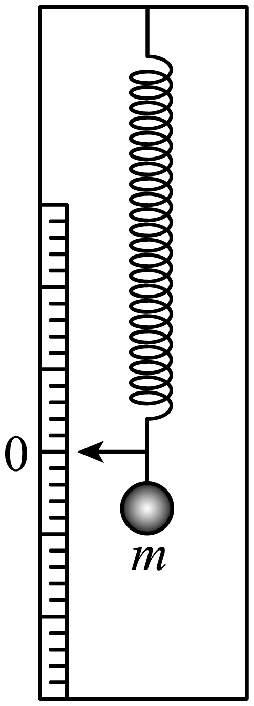

# Physics - 题目 2774

**ID**: dec8857cbe7b4138a982fa676d0352e4
**年级**: Grade 11
**难度**: Easy
**题型**: Calculation

## 题目
某学习小组的同学设计制作了一个“竖直加速度测量仪”测量竖直运行电梯的加速度。​​​​​​​‌测量仪如图所示，轻弹簧上端固定在测量仪外壳上，弹簧下端悬挂一个小球，弹簧左侧沿竖直方向固定一标尺。当小球静止时，弹簧下端的指针所指标尺位置标为“0”刻度线。将测量仪沿竖直方向固定在电梯轿厢侧壁上。已知弹簧的劲度系数为k，小球质量为m，重力加速度为g，弹簧始终在弹性限度内。（1）当电梯静止时，求弹簧的伸长量x_{0}；（2）在标尺的刻度值x处可标注电梯加速度a的大小和方向，请说明标注依据。

## 解答

1. （1）小球处于静止状态，根据二力平衡 $kx{{}_{0}}=mg$ ，解得 $x{{}_{0}}=\frac {mg}{k}$
2. （2）以“0”刻度线为坐标原点，选取竖直向上为正方向，建立一维坐标系。当指针指在刻度值为x的刻度线时，根据牛顿第二定律 $-k(x-x{{}_{0}})-mg=ma$ ，解得 $a=\frac {-kx}{m}$ ，可知加速度a与刻度值x一一对应，可以在刻度值x处，标注加速度值为 $-\frac {kx}{m}$ 。当x< 0时，a> 0，表示电梯加速度方向竖直向上；当x>0时，a< 0，表示电梯加速度方向竖直向下。

## 知识点

**中文**:
  - 两类动力学问题

**English**:
  - Two Types of Dynamics Problems

---
