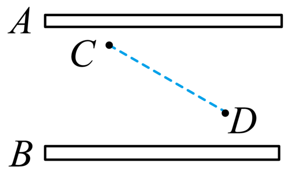

# Physics - 题目 1

**ID**: ecee719cf27a448296868814f43c437f
**年级**: Grade 11
**难度**: Easy
**题型**: Calculation

## 题目
如图所示，两平行金属板 $A、B$ 间有一匀强电场， $C、D$ 为电场中的两点，且 $CD=4{\rm{c}}{\rm{m}}$ ，其连线的延长线与金属板 $\mathrm{A}$ 成 $30{}\degree $ 角，已知电子从 $C$ 点移到 $D$ 点的过程中电场力做功为 $-4.8\times 10{^{-17}}{\rm{J}}$ ，元电荷 $e=1.6\times 10{^{-19}}{\rm{C}}$ 。​​​​​​​‌求：（1） $C、D$ 两点间的电势差 $U{{}_{CD}}$ ，匀强电场场强 $E$ 的大小和方向?（2）若选取 $\mathrm{A}$ 板的电势 $φ{{}_{A}}=0，C$ 点距 $\mathrm{A}$ 板 $1{\rm{c}}{\rm{m}}$ ，电子在 $D$ 点的电势 $φ{{}_{D}}$ 和电势能为多少?

## 解答

1. （1）电子从 $C$ 点移到 $D$ 点，根据电势差的定义，有 $U{{}_{CD}}=\frac {W{{}_{CD}}}{q}=300{\rm{V}}$ ，电场强度 $E=\frac {U{{}_{CD}}}{d{{}_{CD}}}=\frac {300}{4\times 10{^{-2}}\times {\rm{s}}{\rm{i}}{\rm{n}}30{}\degree }{\rm{V}}/{\rm{m}}=1.5\times 10{^{4}}{\rm{V}}/{\rm{m}}$ ，方向垂直极板向下。
2. （2） $AD$ 两点的电势差 $U{{}_{AD}}=Ed{{}_{AD}}=1.5\times 10{^{4}}\times 3\times 10{^{-2}}{\rm{V}}=450{\rm{V}}$ ，由 $U{{}_{AD}}=φ{{}_{A}}-φ{{}_{D}}$ ，其中 $φ{{}_{A}}=0$ ，可得 $φ{{}_{D}}=-450{\rm{V}}$ ，电子在 $D$ 点的电势能为 $E{{}_{P}}=qφ{{}_{D}}=-1.6\times 10{^{-19}}\times \left ({-450}\right ){\rm{J}}=7.2\times 10{^{-17}}{\rm{J}}$

## 知识点

**中文**:
  - 电势能与静电力做功

**English**:
  - Electric Potential Energy and Work Done by Electrostatic Force

---
