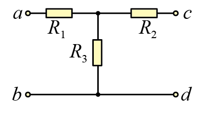

# Physics - 题目 708

**ID**: ffebdf25ba3b42b9b414710375eba4d7
**年级**: Grade 11
**难度**: Easy
**题型**: Calculation

## 题目
一个T型电路如图所示，电路中的电阻R_{1}=1Ω，R_{2}=12Ω，R_{3}=4Ω，另有一测试电源，电源提供的电压恒为10V，内阻忽略不计。​​​​​​​‌(1)当cd端短路时，ab之间的等效电阻是多少？(2)当ab两端接通测试电源时，cd两端的电压是多少？

## 解答

1. （1）当cd端短路时，ab之间的结构是R_{2}、R_{3}并联后和R_{1}串联，等效电阻为
2. $R=\frac {R{{}_{2}}R{{}_{3}}}{R{{}_{2}}+R{{}_{3}}}+R{{}_{1}}=\frac {12\times 4}{12+4}Ω+1Ω=4Ω$
3. （2）当ab两端接通测试电源时，cd两端的电压等于电阻R_{3}两端的电压，为
4. $U{{}_{cd}}=U{{}_{3}}=\frac {R{{}_{3}}}{R{{}_{1}}+R{{}_{3}}}E=\frac {4}{1+4}\times 10{\rm{V}}=8{\rm{V}}$

## 知识点

**中文**:
  - 串联电路和并联电路中的电流、电压、电阻的关系及其应用

**English**:
  - I, U, R Relations in Series/Parallel Circuits

---
