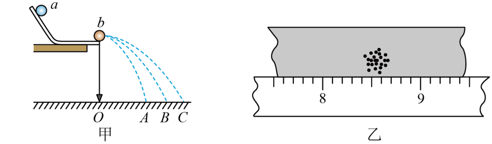

# Physics - 题目 2017

**ID**: 1c4b4446749b470197023ba3ab3fb3aa
**年级**: Grade 11
**难度**: Easy
**题型**: Experiment

## 题目
用如图甲所示的实验装置“验证动量守恒定律”，在轨道下方硬的水平地面上铺上白纸，白纸上放复写纸，小球落地时会在白纸上留下印迹。​​​​​​​‌小球a、b的大小相等，质量分别为 $m{{}_{a}}$ 、 $m{{}_{b}}$ ，小球a每一次从斜槽上同一点由静止释放，斜槽轨道末端未放小球b时，小球a的落地点是B点。斜槽轨道末端放小球b时，小球a、b的落地点分别是A点和C点。斜槽轨道末端的正下方是O点，纸上O点到A、B、C各点的距离分别为OA、OB、OC。（1）本实验必须满足的条件是。

## 解答

1. （1）由于小球a每次都从同一高度由静止释放，小球克服阻力做功相同，则小球到斜槽底端速度大小相等，可知，斜槽轨道的斜面不必是光滑的，A错误；为了确保小球飞出后才是做平抛运动，斜槽轨道末端的切线一定是水平的，B正确；为了保证两球碰后都向右运动，不发生反弹，小球a的质量要大于小球b的质量，C正确；为了使小球发生对心正碰，使碰撞前后速度能沿水平方向，需要使得小球a与小球b的体积应当相同，D正确。
2. （2）若两球碰撞过程动量守恒，则有 $m{{}_{a}}v{{}_{0}}=m{{}_{a}}v{{}_{1}}+m{{}_{b}}v{{}_{2}}$ ，小球做平抛运动则有 $h=\frac {1}{2}gt{^{2}}$ ， $v{{}_{0}}=\frac {OB}{t}$ ， $v{{}_{1}}=\frac {OA}{t}$ ， $v{{}_{2}}=\frac {OC}{t}$ ，解得 $m{{}_{a}}\cdot OB=m{{}_{a}}\cdot OA+m{{}_{b}}\cdot OC$
3. （3）为了减小误差，用尽量小的圆把各落点位置圈起来，圆心就表示落点的平均位置，刻度尺的0刻度到圆心的距离即为球a的水平位移，则有 $OB=8.55{\rm{c}}{\rm{m}}$

## 知识点

**中文**:
  - 研究斜槽末端小球碰撞时的动量守恒

**English**:
  - Momentum Conservation in Collision at End of Inclined Ramp

---
