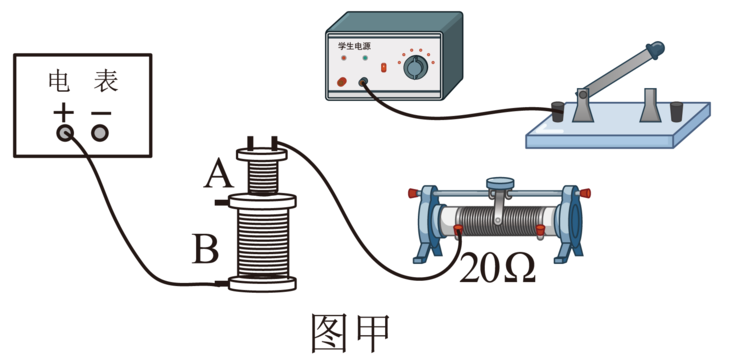

# Physics - 题目 2075

**ID**: 219f925bfa8641cfa455a25e64ee85d4
**年级**: Grade 11
**难度**: Easy
**题型**: Experiment

## 题目
为探究感应电流产生的条件，几位同学做了如下的实验。​​​​​​​‌小李同学选用图甲中的器材模仿法拉第的实验进行探究。（1）请在实物图中，用笔画线代替导线将电路补充完整。（2）闭合开关进行实验前，滑动变阻器滑片 ${\rm{P}}$ 应该滑置在最（填“左”或“右”）端。（3）正确连接电路后，下列说法正确的是（      ）

## 解答

1. （1）将学生电源、电键、变阻器、线圈A串联成一个回路，注意滑动变阻器接一上一下两个接线柱；再将电表与线圈B串联成另一个回路，电路图如图所示
2. 
3. （2）为保护电路中的仪器，闭合开关进行实验前，滑动变阻器滑片P应该滑置在最右端，其有效阻值最大，当闭合开关后，回路中的电流最小。
4. （3）开关闭合，拔出线圈B中的线圈A的过程中，通过线圈B中的磁通量减少，电表的指针发生偏转，A正确；开关闭合，线圈A中电流稳定后，通过线圈B的磁通量不变，表的指针不偏转，B错误；开关闭合后，移动滑动变阻器的滑片，流过线圈A的电流发生变化，则线圈A产生的磁场发生变化，通过线圈B的磁通量发生变化，线圈B中出现感应电流，电表的指针偏转，C错误，D正确。

## 知识点

**中文**:
  - 产生感应电流的条件

**English**:
  - Conditions for Induced Current

---
