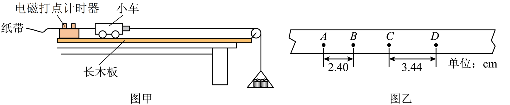

# Physics - 题目 2366

**ID**: 38d85f071300495aa5d99203725b7c25
**年级**: Grade 11
**难度**: Easy
**题型**: Experiment

## 题目
2023年暑假期间，物理爱好者陈向阳为“探究加速度与力、质量的关系”，独立设计了如图甲所示的实验装置。​​​​​​​‌若小车质量用m_{1}表示，砝码和盘的质量用m_{2}表示，交流电的频率为50 Hz，除了装置图中所给的器材外，另外备有复写纸、低压交流电源、电键及导线若干。（1）除了上面涉及的实验器材外，本次实验还缺少的器材有。（2）如图乙所示为某次实验得到的一条纸带，相邻计数点间还有四个点没有画出。由于疏漏，B、C两计数点之间的距离忘记了标注，根据纸带上现有的数据情况，可计算出小车运动的加速度为m/s^{2}。

## 解答

1. （1）纸带上计数点间距离需要测量，还缺少刻度尺。
2. （2）因为电源频率为50Hz，所以打点时间间隔为 $t=0.02{\rm{s}}$
3. 而相邻计数点间还有4个点没画出，即计数点时间间隔为 $T=0.1{\rm{s}}$ ，根据 $x{{}_{3}}-x{{}_{1}}=2aT{^{2}}$ ，可得 $a=\frac {x{{}_{3}}-x{{}_{1}}}{2T{^{2}}}=\frac {3.44-2.40}{2\times (0.1){^{2}}}{\rm{c}}{\rm{m}}{\rm{/}}{\rm{s}}{^{{{2}}}}=0.52{\rm{m}}{\rm{/}}{\rm{s}}{^{{{2}}}}$ 。

## 知识点

**中文**:
  - 实验：探究加速度与力、质量的关系

**English**:
  - Experiment: Acceleration vs Force and Mass (Newton's 2nd Law)

---
