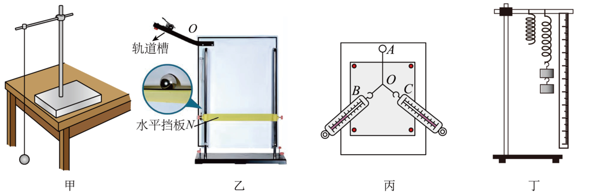

# Physics - 题目 1628

**ID**: 3c18e819cfce48f6aa6a693777b599ae
**年级**: Grade 11
**难度**: Easy
**题型**: Experiment

## 题目
以下实验操作会给实验带来误差的是。​​​​​​​‌

## 解答

1. 测单摆振动周期时，应选择摆球的最低点作为计时起点，选择摆球的最高点作为计时起点会带来误差，A正确；做平抛运动实验时，轨道槽可以不光滑，但必须保持水平，所以不会带来误差，B错误；拉橡皮筋时弹簧测力计的外壳与白纸接触有摩擦，不影响测量细绳上的拉力，所以不会影响实验结果，C错误；测弹簧测力计劲度系数时，挂上砝码后弹簧测力计显示的是砝码的重力，计算弹簧形变量时，对应的是挂上砝码后的长度与在自重下的弹簧长度差，利用ΔF=kΔx可知，劲度系数无误差，D错误。

## 知识点

**中文**:
  - 实验：探究单摆的周期与摆长的关系
  - 实验：探究平抛运动的特点

**English**:
  - Experiment: Period vs Length of Pendulum
  - Experiment: Characteristics of Projectile Motion

---
