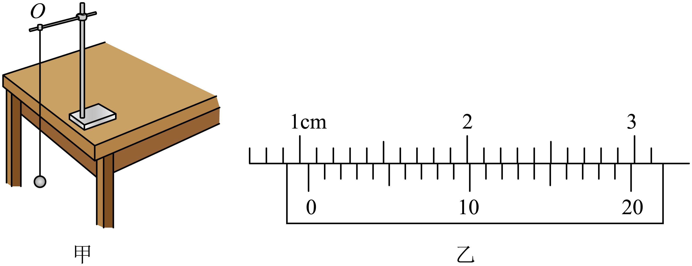

# Physics - 题目 2878

**ID**: ecae641d435943708f5261ef902512c5
**年级**: Grade 11
**难度**: Easy
**题型**: Experiment

## 题目
邓同学在实验室做“用单摆测定重力加速度”的实验，实验装置如图甲所示。​​​​​​​‌(1)该同学用游标卡尺测量摆球的直径，测量结果如图乙所示，则摆球的直径 $d=$${\rm{c}}{\rm{m}}$ 。(2)将摆球从平衡位置拉开一个合适的角度，由静止释放摆球，摆球在竖直平面内稳定摆动后，当摆球通过平衡位置时从1开始计数，并同时开始计时，当摆球第 $n$ 次通过平衡位置时停止计时，记录的时间为 $t$ ，该单摆的振动周期 $T=$（用 $t$ 、 $n$ 表示）。(3)该同学多次改变摆线长度 $L$ 并测出对应的摆动周期 $T$ ，并根据实验数据作出了 $T{^{2}}-L$ 的关系图像，结果发现 $T{^{2}}-L$ 图线是一条斜率为 $k$ 、不过原点的倾斜直线，则当地的重力加速度大小 $g=$（用 $k$ 和 ${\rm{π}}$ 表示）。(4)若该同学利用单摆周期公式计算当地的重力加速度大小 $g$ ，发现测得的 $g$ 值偏大，可能的原因是。

## 解答

1. （1）图乙可知游标卡尺是20分度，精度为0.05mm，摆球的直径 $d={{1}}{{0}}{\rm{m}}{\rm{m}}{{+}}{{0}}{{.}}{{0}}{{5}}{\rm{m}}{\rm{m}}{\rm{×}}{{1}}{{4}}{\rm{=}}{{1}}{{0}}{{.}}{{7}}{{0}}{\rm{m}}{\rm{m}}{\rm{=}}{{1}}{{.}}{{0}}{{7}}{{0}}{\rm{c}}{\rm{m}}$
2. （2）从摆球第1次通过平衡位置开始计时，到第n次通过平衡位置，经过的时间t内，单摆完成全振动的次数 $N=\frac {n-1}{2}$
3. 则单摆的振动周期 $T=\frac {t}{N}=\frac {2t}{n-1}$
4. （3）题意可得单摆周期 $T=2π\sqrt {\frac {L+\frac {d}{2}}{g}}$
5. 整理得 $T{^{2}}=\frac {4π{^{2}}}{g}L+\frac {2π{^{2}}d}{g}$
6. 则斜率 $k=\frac {4π{^{2}}}{g}$
7. 则 $g=\frac {4π{^{2}}}{k}$
8. （4）A．开始计时时，秒表提前按下，测量时间t偏大，可知周期T偏大，再根据 $g=\frac {4π{^{2}}}{T{^{2}}}L$
9. 可知T偏大则g值偏小，A错误；
10. B．摆线上端松动使摆线长度增加，而计算时用的是初始摆长（偏小），结合以上分析可知，L偏小则g值偏小，B错误；
11. C．把n当作单摆全振动次数，则计算出的周期比实际值偏小，结合以上分析可知，T偏小则g值偏大 ，C正确。

## 知识点

**中文**:
  - 实验：用单摆测量重力加速度

**English**:
  - Experiment: Measuring g with Simple Pendulum

---
