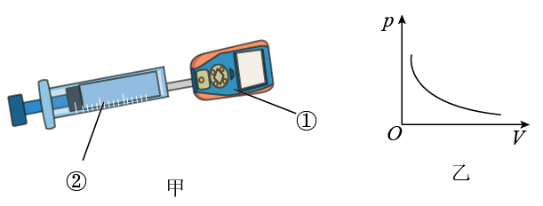

# Physics - 题目 12

**ID**: f238cf683ebf4d31b939b81fa7115e1f
**年级**: Grade 11
**难度**: Easy
**题型**: Experiment

## 题目
如图甲为研究一定质量的气体压强与体积关系的实验装置。​​​​​​​‌（1）图中①为传感器，该实验需要保持气体的和不变。（2）某同学在实验中测出多组气体压强与体积值后，利用DIS实验绘图功能，得到如图乙所示的p－V图像，则由图（选填“能”或“不能”）得到压强与体积成反比的结论。（3）某同学在实验中得到的数据如下：次数123456压强p/kPa116.2124.6134.3145.6158.8173.2体积V/cm^{3}14131211109体积倒数$\frac {1}{V}$ /cm^{－}^{3}0.0710.0770.0830.0910.1000.111pV乘积1 626.81 619.81 611.61 601.61 588.01 558.8表中数据表明气体的pV乘积随着气体体积的减小而减小，若实验中很好地满足了实验需要满足的条件，则出现该结果的原因是。

## 解答

1. （1）[1][2][3]题图甲中①为压强传感器；研究一定质量的气体压强与体积关系时，应保持气体的质量和温度不变；
2. （2）[4]压强与体积成反比的图像应为双曲线的一支，题图乙的p－V图像不能确定是不是双曲线的一支，所以不能确定压强与体积成反比；
3. （3）[5]实验时注射器内的空气向外发生了泄漏。

## 知识点

**中文**:
  - 实验：探究气体等温变化的规律

**English**:
  - Experiment: Investigating Isothermal Change (Boyle's Law)

---
