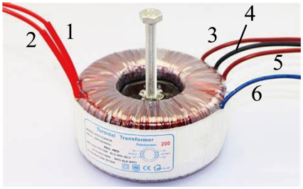

# Physics - 题目 2932

**ID**: fab317a44a0e48c0953dadcd7c6d93a5
**年级**: Grade 11
**难度**: Easy
**题型**: Experiment

## 题目
某同学从家里旧电器上拆得一环形变压器（如图），但变压器的铭牌已经污损无法看清参数。​​​​​​​‌该同学利用高中所学知识来探究该变压器原﹑副线圈两端的电压与匝数之间的关系，操作步骤如下：（1）确定绕组：结合铭牌残存数据可知图中1、2为输入端，3、4和5、6为两次级绕组输出端，用多用电表欧姆挡测量发现都导通。（2）测量变压器的初级（原）两次级（副）线圈匝数分别为n_{1}、n_{2}和n_{3}：先在该变压器闭合铁芯上紧密缠绕n=80匝漆包细铜线，并将理想交流电压表接在细铜线两端；然后在初级线圈（1、2端）上输入有效值为220V的交流电，若理想交流电压表的示数为4.0V，则初级线圈的匝数n_{1}=；把理想交流电压表分别接在3、4和5、6端，示数分别为12.0V、5V，则次级线圈的匝数n_{2}=，n_{3}=。（3）该同学通过裸露部分观察，发现该变压器使用了两种规格的铜线绕制，结合前面数据可以推想其中较粗的铜线属于（填“初级线圈”或“次级线圈”）。（4）考虑到变压器工作时有漏磁损失，实验中测得的原线圈匝数（填“大于”“等于”或“小于”）原线圈的实际匝数。

## 解答

1. （2）[1][2][3]根据理想变压器变压规律得 $\frac {n{{}_{1}}}{n}=\frac {U{{}_{1}}}{U}$ ， $\frac {n{{}_{2}}}{n{{}_{1}}}=\frac {U{{}_{2}}}{U{{}_{1}}}$ ， $\frac {n{{}_{3}}}{n{{}_{1}}}=\frac {U{{}_{3}}}{U{{}_{1}}}$ ，解得 $n{{}_{1}}=4400$ ， $n{{}_{2}}=240$ ， $n{{}_{3}}=100$
2. （3）[4]由实验数据可知变压器为降压变压器，次级线圈电流大一些，所以需要较粗铜线绕制。
3. （4）[5]变压器的铁芯漏磁，会造成副线圈电压实际值比理论值小，实验中测得的原线圈匝数大于原线圈的实际匝数。

## 知识点

**中文**:
  - 理想变压器原、副线圈两端的电压、功率、电流关系及其应用

**English**:
  - Voltage, Power, Current Relations in Ideal Transformers

---
