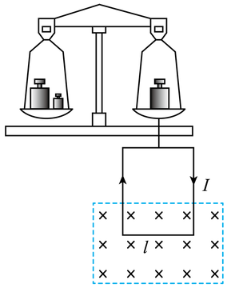

# Physics - 题目 1781

**ID**: f5a362e81d3b4315931dc3e1284e4af4
**年级**: Grade 11
**难度**: Easy
**题型**: Fill-in-the-blank

## 题目
如图所示，某同学用电流天平测量匀强磁场的磁感应强度。​​​​​​​‌(1)电流天平的右臂挂着矩形线圈，匝数为n，线圈的水平边长为l，处于匀强磁场内，磁场方向与线圈平面垂直.当线圈中通过电流I时，调节砝码使两臂达到平衡，然后使电流反向，大小不变这时需要在左盘中增加质量为m的砝码，才能使两臂再达到新的平衡。已知重力加速度为g，则匀强磁场的磁感应强度B＝（用题中所给物理量的符号表示）；(2)当n＝9，l＝10.0 cm，I＝0.10 A，m＝8.78 g时，g取10 m/s^{2}，则磁感应强度大小等于T（保留2位有效数字）。

## 解答

1. （1）设原来左盘内砝码质量为m_{1}，右盘内砝码及线圈的总质量为m_{2}，平衡时有 $m{{}_{1}}g=m{{}_{2}}g-nBIl$ ，电流方向改变后，有 $(m{{}_{1}}+m)g=m{{}_{2}}g+nBIl$ ，两式相减得 $B=\frac {mg}{2nIl}$
2. （2）根据 $B=\frac {mg}{2nIl}$ ，代入数据得 $B\approx 0.49{\rm{\;}}{\rm{T}}$

## 知识点

**中文**:
  - 磁感应强度

**English**:
  - Magnetic Induction

---
