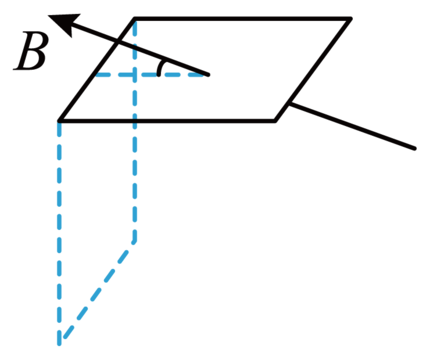

# Physics - 题目 1497

**ID**: 031ef24a49b1477898ced23e9bc77915
**年级**: Grade 11
**难度**: Easy
**题型**: Multiple-choice

## 题目
如图所示，一水平放置的N匝矩形线框面积为S，匀强磁场的磁感应强度为B，方向斜向上，与水平面成30°角，现若使矩形框以左边的一条边为轴转到竖直的虚线位置，则此过程中磁通量的变化量的大小是（      ）​​​​​​​‌

## 解答

1. 矩形线圈abcd如图所示放置，匀强磁场方向向左上方，平面水平放置时通过线圈的磁通量为 ${\rm Φ_{1}=BSsinθ=\mathit{BS}sin30°＝}\frac {1}{2}{\rm \mathit{BS}}$ ．当规定此时穿过线圈为正面，则当线圈绕ad轴转90°角时，穿过线圈反面，则其的磁通量Φ_{2}=-BScosθ′ ${\rm =−\mathit{BS}cos30°＝−}\frac {\sqrt {3}}{2}{\rm \mathit{BS}}$ ．因此穿过线圈平面的磁通量的变化量为 ${\rm △Φ＝Φ_{2}−Φ_{1}＝−} -\frac {\sqrt {3}}{2}BS-\frac {1}{2}BS=-\frac {\sqrt {3}+1}{{2}}BS$ ．选B。

## 知识点

**中文**:
  - 磁通量

**English**:
  - Magnetic Flux

---
