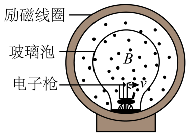

# Physics - 题目 2425

**ID**: 11e26bca2d1643499883a4158eb455b4
**年级**: Grade 11
**难度**: Easy
**题型**: 不定项选择题

## 题目
如图为洛伦兹力演示仪的结构图，励磁线圈产生的匀强磁场方向垂直纸面向外，电子束由电子枪产生，其速度方向与磁场方向垂直。​​​​​​​‌电子速度大小可通过电子枪的加速电压来控制，磁感应强度可通过励磁线圈的电流来调节。下列说法正确的是（      ）

## 解答

1. AB．根据电子所受洛伦兹力的方向结合右手定则判断励磁线圈中电流方向是顺时针方向，电子在加速电场中加速，由动能定理有 $eU=\frac {1}{2}mv{{}_{0}^{2}}$ ，电子在匀强磁场中做匀速圆周运动，洛伦兹力充当向心力，有 $ev{{}_{0}}B=m\frac {v{{}_{0}^{2}}}{r}$ ，解得 $r=\frac {mv{{}_{0}}}{eB}=\frac {1}{B}\sqrt {\frac {2Um}{e}}$ ，周期为 $T=\frac {2πm}{eB}$ ，可知增大电子枪加速电压，电子束的轨道半径变大，周期不变，A正确，B错误；
2. C．同理可得增大励磁线圈中的电流，电流产生的磁场增强，则电子束的轨道半径变小，C正确；
3. D．同时增大电子枪的加速电压和励磁线圈的电流，电流产生的磁场增强，根据 $T=\frac {2πm}{eB}$ ，可知电子做圆周运动的周期变小，D错误。选AC。

## 知识点

**中文**:
  - 带电粒子在匀强磁场中的运动
  - 带电粒子的运动半径和周期公式及其简单应用

**English**:
  - Motion of Charged Particles in Uniform Magnetic Field
  - Radius and Period Formulas and Applications

---
