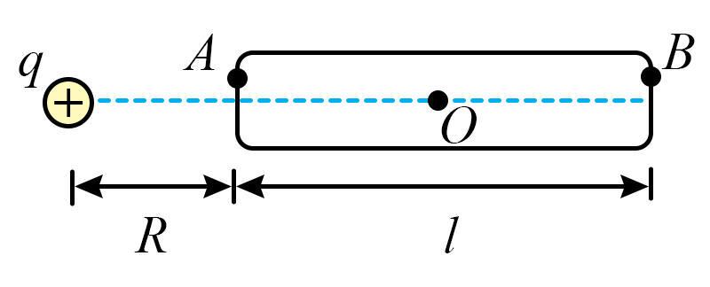

# Physics - 题目 538

**ID**: 213bfcbf45a3413b814e93e76b8d139f
**年级**: Grade 11
**难度**: Easy
**题型**: Multiple-choice

## 题目
如图所示，原来不带电，长为l的导体棒水平放置，现将一个电荷量为 $+q$ （ $q>0$ ）的点电荷放在棒的中心轴线上距离棒的左端R处，A、B分别为导体棒左右两端的一点，静电力常量为k。​​​​​​​‌当棒达到静电平衡后，下列说法正确的是（      ）

## 解答

1. 由静电感应可知，棒左端感应出负电荷，右端感应出正电荷，A错误；q在棒中心O处产生的电场方向向右，根据平衡关系可知，棒上感应电荷在棒中心O处产生的电场方向向左，大小相同，为 $E=\frac {kq}{(R+\frac {l}{2}){^{2}}}{\rm ，C}$ 正确，B错误；导体棒是等势体，左右端电势相等，若用一根导线将A、B相连，导线上不会产生电流，D错误。

## 知识点

**中文**:
  - 静电感应现象及特点

**English**:
  - Electrostatic Induction Phenomena and Characteristics

---
