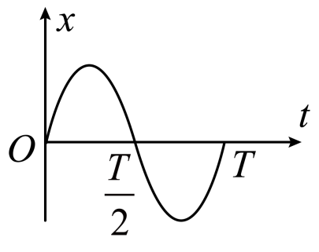

# Physics - 题目 2912

**ID**: 3b994009644947719c00df35fb38526a
**年级**: Grade 11
**难度**: Easy
**题型**: Multiple-choice

## 题目
公路上匀速行驶的货车受一扰动，车上货物随车厢底板上下振动但不脱离底板．一段时间内货物在竖直方向的振动可视为简谐运动，周期为T．取竖直向上为正方向，以t＝0时刻作为计时起点，其振动图像如图所示，则​​​​​​​‌

## 解答

1. t=T/4时，货物加速度方向向下，失重，货物对车厢底板的压力最小，A错误；t=T/2时，货物加速度为零，货物对车厢底板的压力等于重力大小，B错误；t=3T/4时，货物加速度方向向上且最大，超重，此时货物对车厢底板的压力最大，C正确、D错误．

## 知识点

**中文**:
  - 简谐运动的函数与图像

**English**:
  - Functions and Graphs of SHM

---
