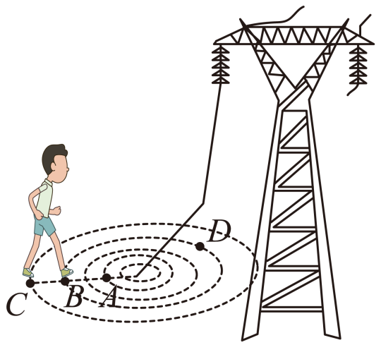

# Physics - 题目 493

**ID**: 3d1a3a551ff24c65add03a9ebde638ad
**年级**: Grade 11
**难度**: Easy
**题型**: Multiple-choice

## 题目
我国的特高压直流输电是中国在高端制造领域领先世界的一张“名片”，特别适合远距离输电，若直流高压线掉到地上时，它就会向大地输入电流，并且以高压线与大地接触的那个位置为圆心，形成一簇如图所示的等差等势线同心圆， $A$ 、 $B$ 、 $C$ 、 $D$ 是等势线上的四点，当人走在地面上时，如果形成跨步电压就会导致两脚有电势差而发生触电事故，则（      ）​​​​​​​‌

## 解答

1. A．高压线掉到地上时，它就会向大地输入电流，圆心处的电势最高，向外越来越低，电势的大小为 $φ{{}_{{\rm{A}}}}>φ{{}_{{\rm{B}}}}=φ{{}_{{\rm{D}}}}>φ{{}_{{\rm{C}}}}$ ，A错误；
2. B．场强看等势线的疏密，由图可知场强的大小为 $E{{}_{{\rm{A}}}}>E{{}_{{\rm{B}}}}=E{{}_{{\rm{D}}}}>E{{}_{{\rm{C}}}}$ ，B正确；
3. C． $B$ 和 $D$ 在同一条等势线上，人从 $B$ 沿着圆弧走到 $D$ 不会发生触电，C错误；
4. D． $AB$ 的平均场强大于 $BC$ 的平均场强， $AB$ 的电势差等于 $BC$ 电势差的二倍，根据 $E=\frac {U}{d}$ 可以定性判断出 $AB$ 间距离小于2倍 $BC$ 间距离，D错误；
5. 故选B。

## 知识点

**中文**:
  - 等势面

**English**:
  - Equipotential Surface

---
