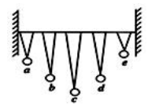

# Physics - 题目 1738

**ID**: 41e926a3c7fa4f6a8d7f27f0cdfb766f
**年级**: Grade 11
**难度**: Easy
**题型**: Multiple-choice

## 题目
有一根张紧的水平绳上挂有 $5$ 个双线摆，其中 $b$ 摆摆球质量最大，另 $4$ 个摆球质量相等，摆长关系为 ${L}_{c}>{L}_{b}={L}_{d}>{L}_{a}>{L}_{e}$ ，如图所示，现将 $b$ 摆垂直纸面向里拉开一微小角度，放手后让其振动，经过一段时间，其余各摆均振动起来，达到稳定时（      ）​​​​​​​‌

## 解答

1. 在 $b$ 摆的带动下， $acde$ 均做受迫振动，受迫振动的频率等于驱动率的频率，当驱动力的频率接近物体的固有频率时，振幅最大，即共振。
2. 本题考查受迫振动的周期和共振现象．自由振动与受迫振动是从振动形成的原因来区分的．要明确共振时振幅最大，而单摆的频率取决于摆长，要牢记周期和频率公式。
3. $\mathrm{A}\mathrm{B}．$ 摆垂直纸面向里拉开一微小角度后释放，使得其它四个单摆都做受迫振动，受迫振动的频率等于驱动力的频率，所以 $4$ 个单摆的频率相等，则周期一定相同；故A错误，B正确；
4. $\mathrm{C}\mathrm{D}．$ 当驱动力的频率接近物体的固有频率时，振幅最大，即共振。根据 $T=2\pi \sqrt{\frac{L}{g}}$ 知， $d$ 摆的摆长与 $b$ 摆摆长相等，则驱动力的周期等于 $b$ 摆的固有周期， $d$ 摆发生共振，振幅最大。故CD错误。

## 知识点

**中文**:
  - 单摆周期公式及其应用

**English**:
  - Pendulum Period Formula and Applications

---
