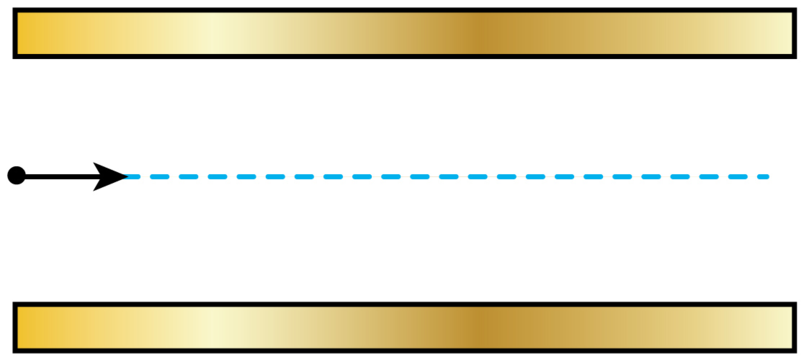

# Physics - 题目 1987

**ID**: 428b0e37d73647eca0ea01ecce3e1959
**年级**: Grade 11
**难度**: Easy
**题型**: Multiple-choice

## 题目
如图，在两水平极板间存在匀强电场和匀强磁场，磁场方向垂直于纸面向里。​​​​​​​‌一带正电粒子以某一速度沿水平直线通过两极板。若不计重力，则电场的方向为（      ）

## 解答

1. 根据左手定则可知粒子受到的洛伦兹力竖直向上，又因水平直线通过两极板，则受力平衡，所以粒子所受的电场力竖直向下，根据正电荷受到的电场力方向与电场强度方向相同，可得电场的方向竖直向下，选B。

## 知识点

**中文**:
  - 安培力的方向（左手定则）

**English**:
  - Direction of Ampere Force (Left-Hand Rule)

---
