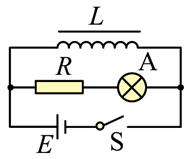

# Physics - 题目 980

**ID**: 45f76ee0de1a47c4804fbb9b4ee9ed2f
**年级**: Grade 11
**难度**: Easy
**题型**: Multiple-choice

## 题目
如图所示的电路中，电阻R和自感线圈L的电阻值相等且小于灯泡A的电阻。​​​​​​​‌下列说法正确的是（      ）

## 解答

1. AB．接通S，灯泡A立即变亮，由于线圈产生自感电动势阻碍电流的增加，可知开始时A灯较亮，随自感电动势减小，则通过线圈L的电流增加，则灯泡逐渐变暗，但最终不会熄灭，选项AB错误；
2. CD．由于电阻R和自感线圈L的电阻值都很小，所以稳定时通过灯泡的电流比线圈的电流小，断开S时，由于线圈阻碍电流变小，在线圈L、电阻R以及灯泡A中形成新的回路，则导致灯泡A将闪亮一下后逐渐熄灭。断开S后的瞬间，通过灯A的电流方向跟断开前的电流方向相反，故C正确，D错误；
3. 故选C。

## 知识点

**中文**:
  - 自感现象的理解与分析

**English**:
  - Understanding and Analysis of Self-Induction

---
