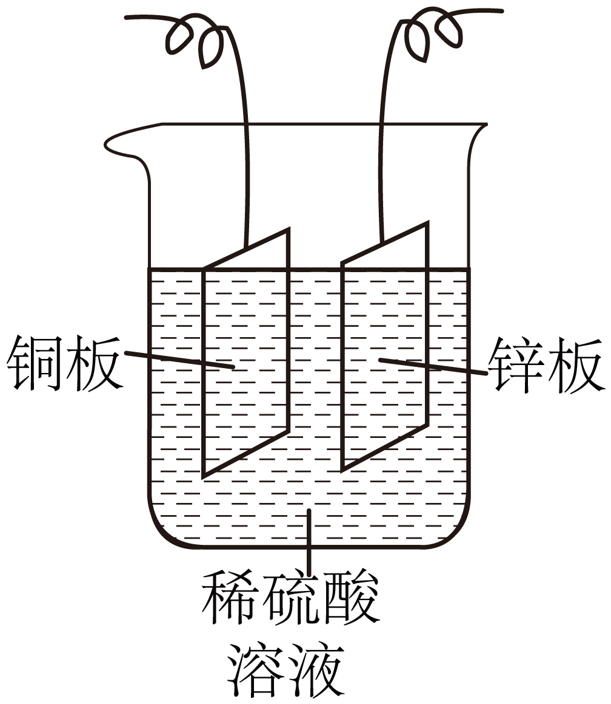

# Physics - 题目 972

**ID**: 52554a2cca0847958fa67f2996cd0d8f
**年级**: Grade 11
**难度**: Easy
**题型**: Multiple-choice

## 题目
如图所示是伏打电池的结构简图，铜板和锌板用导线相连同时浸在稀硫酸溶液中，由于锌板与稀硫酸溶液之间锌离子的溶解作用，以及铜板与稀硫酸溶液之间正离子的沉积作用，在两板间形成电势差。​​​​​​​‌关于该伏打电池，下列说法中正确的是（      ）

## 解答

1. AD．伏打电池的工作过程可以简单描述为，在电池中，锌电极会释放出电子，形成锌离子，同时产生电流，这些电子会通过外部电路流向铜电极使得铜离子接受电子，还原成铜原子；同时，电解质中的阴离子会向锌电极移动，维持电池中的电中和。这样，电池就能够持续地产生电流，供给外部设备使用，铜板为电池的正极，锌板为电池的负极，该电池内部的电流从锌板流向铜板，AD错误；
2. B．该电池是将化学能转化为电能，B错误；
3. C．电池是通过化学反应产生电势差，其非静电作用为化学作用，C正确。
4. 选C。

## 知识点

**中文**:
  - 非纯电阻电路中的电功、电功率和电热

**English**:
  - Work, Power, and Heat in Non-Pure Resistive Circuits

---
