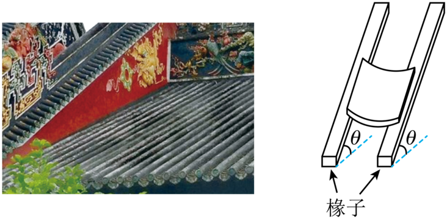

# Physics - 题目 2452

**ID**: 6c9c0496d3f9436792bfe58ebc9e4aea
**年级**: Grade 11
**难度**: Easy
**题型**: Multiple-choice

## 题目
中国传统建筑一般采用瓦片屋顶，屋顶结构可简化为图，若一块弧形瓦片静止在两根相互平行的倾斜椽子正中间。​​​​​​​‌已知椽子与水平面夹角均为 $θ$ ，该瓦片质量为m，椽子与瓦片间的动摩擦因数为 $μ$ ，重力加速度为g，则（      ）

## 解答

1. 瓦片静止，处于平衡状态所受合力为零，A错误；两根椽子对瓦片的支持力的合力为 $mg{\cos}θ$ ，但瓦片有弧度，所以每根椽子对瓦片的支持力大小不是 $0.5mg{\cos}θ{\rm ，B}$ 错误；椽子对瓦片的作用力包括支持力和摩擦力，合力大小为 $mg{\rm ，C}$ 错误；两根椽子对瓦片的摩擦力的合力为 $mg\sin θ$ ，摩擦力方向与椽子平行，所以每根椽子对瓦片的摩擦力大小为 $0.5mg\sin θ{\rm ，D}$ 正确。

## 知识点

**中文**:
  - 用正交分解法分析问题

**English**:
  - Problem Analysis using Orthogonal Decomposition

---
