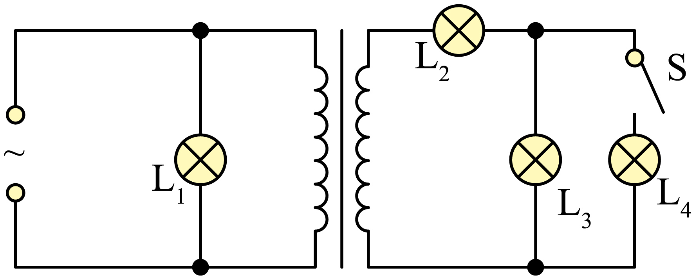

# Physics - 题目 585

**ID**: 74ac0873da684a7b9e562fd710ae97c9
**年级**: Grade 11
**难度**: Easy
**题型**: Multiple-choice

## 题目
如图所示，交流电源输出电压有效值恒定，变压器为理想变压器，灯泡阻值不随温度变化，电路稳定后闭合开关，下列说法正确的是（      ）​​​​​​​‌

## 解答

1. 当S闭合后，原线圈电压和原副线圈匝数比不变，则副线圈电压不变，副线圈对应的总电阻变小，副线圈电流增大，灯泡L_{2}变亮，L_{2}上的电压变大，则L_{3}两端的电压变小，灯泡L_{3}变暗，交流电源输出电压有效值恒定，则灯泡L_{1}上的电压也不变，所以灯泡L_{1}亮度不变。选B。

## 知识点

**中文**:
  - 理想变压器原、副线圈两端的电压、功率、电流关系及其应用

**English**:
  - Voltage, Power, Current Relations in Ideal Transformers

---
