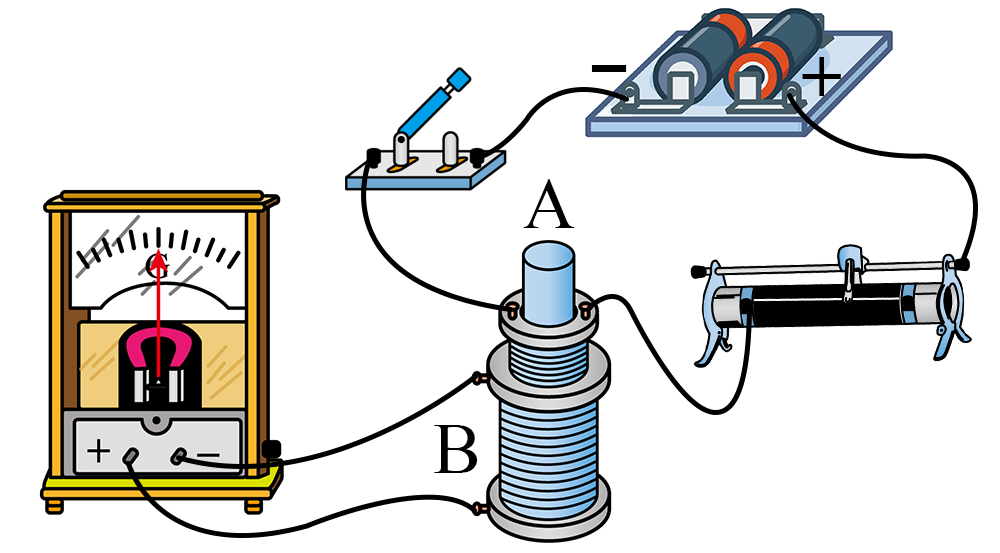

# Physics - 题目 630

**ID**: 81947480a9ea401d864d915bded0ffd7
**年级**: Grade 11
**难度**: Easy
**题型**: Multiple-choice

## 题目
某同学在探究感应电流产生的条件时，进行了如图所示的实验。​​​​​​​‌下面几种情况中，线圈B中有感应电流产生的是（      ）

## 解答

1. 开关闭合一段时间后，线圈A中的电流无变化，穿过线圈B的磁通量不发生变化，线圈中无感应电流，A错误：开关闭合稳定后，快速移动滑动变阻器滑片，线圈A中的电流变化，穿过线圈B的磁通量发生变化，线圈中产生感应电流，B正确；开关断开状态下，穿过线圈B的磁通量为零，快速移动滑动变阻器滑片或将线圈A从线圈B中拔出，穿过线圈B的磁通量不发生变化，线圈中没有感应电流，CD错误。

## 知识点

**中文**:
  - 产生感应电流的条件

**English**:
  - Conditions for Induced Current

---
