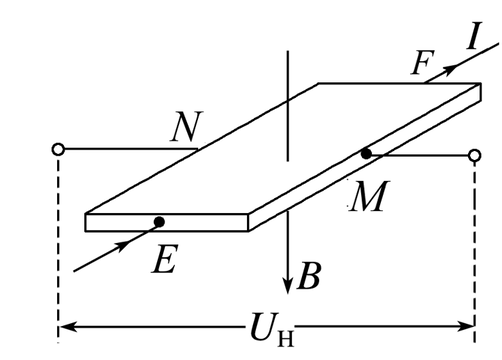

# Physics - 题目 2622

**ID**: 84a24ff5e14f4910b80bd419216e6c86
**年级**: Grade 11
**难度**: Easy
**题型**: Multiple-choice

## 题目
如图所示，在一个很小的矩形半导体薄片上，制作四个电极E、F、M、N，它就成了一个霍尔元件。​​​​​​​‌在E、F间通入恒定的电流I，同时外加与薄片垂直的磁场B，则薄片中的载流子（能够自由移动的带电粒子）就在洛伦兹力的作用下，向着与电流和磁场都垂直的方向漂移，使M、N间出现了电压，称为霍尔电压U_{H}。当磁场方向和电流方向如图所示时，下列说法正确的是    	（      ）

## 解答

1. 设半导体薄片的厚度为d，宽度为b，单位体积内的载流子个数为n，载流子定向运动的速度大小为v。根据平衡条件可得 ${\rm \mathit{q}}\frac{{U}_{\mathrm{H}}}{b}{\rm =\mathit{qvB}}$ ，根据电流的微观表达式可得I=nqSv，其中S=bd，联立解得 ${\rm \mathit{U}_{H}=}\frac{BI}{nqd}$ ，若只改变半导体薄片的厚度d，U_{H}发生变化，故A错误；霍尔电压U_{H}与b无关，若只改变半导体薄片的宽度b，U_{H}不变，故B正确；若将半导体薄片换成形状相同、载流子密度更大的导体薄片，则单位体积内载流子个数n增大，所以U_{H}变小，故C错误；如果载流子带负电，根据左手定则可知载流子向N电极偏转，则电极N的电势低于电极M的电势，故D错误。

## 知识点

**中文**:
  - 霍尔元件

**English**:
  - Hall Element

---
