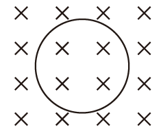

# Physics - 题目 2917

**ID**: 880ddebe344b4d1fbae6f581b4f63490
**年级**: Grade 11
**难度**: Easy
**题型**: Multiple-choice

## 题目
长为 $L=1{\rm{m}}$ 的两根完全相同的软绝缘金属导线放在光滑的水平桌面上，周围有垂直桌面向下的匀强磁场，磁感应强度大小 $B=0.2{\rm{T}}$ 。​​​​​​​‌初始时，两导线两端连接盘绕放置，现在外力作用下拉动导线，使两根导线在 $\Delta t=0.5{\rm{s}}$ 时间内形成一个圆形，如图所示。已知每根导线电阻 $R=0.6Ω$ 。下列说法正确的是（      ）

## 解答

1. A．圆的周长为2L，由
2. $2L=2πr$
3. 解得
4. $r=\frac {L}{π}$
5. 由法拉第电磁感应定律得感应电动势的平均值
6. ${\overline{E}}=\frac {ΔΦ}{Δt}$
7. 其中
8. $ΔΦ=B\cdot ΔS$
9. $ΔS=πr{^{2}}=\frac {L{^{2}}}{π}$
10. 解得
11. ${\overline{E}}=\frac {B\cdot ΔS}{Δt}=\frac {2}{5π}{\rm{V}}$
12. A错误；
13. B．由闭合电路欧姆定律可得，平均电流
14. ${\overline{I}}=\frac {{\overline{E}}}{R{{}_{{\rm{总}}}}}$
15. $R{{}_{{\rm{总}}}}=2R=1.2Ω$
16. 故
17. ${\overline{I}}=\frac {1}{3π}{\rm{A}}$
18. B正确；
19. C．由
20. $q={\overline{I}}\cdot Δt$
21. 可得
22. $q=\frac {1}{6π}{\rm{C}}$
23. C错误；
24. D．由楞次定律和右手定则可得，导线中的电流沿逆时针方向，D错误。
25. 故选B。

## 知识点

**中文**:
  - 法拉第电磁感应定律
  - 线框模型

**English**:
  - Faraday's Law
  - Wire Frame Model

---
