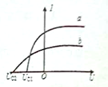

# Physics - 题目 2291

**ID**: 8b88b75c21a04a35a7687b0c8df32678
**年级**: Grade 11
**难度**: Easy
**题型**: Multiple-choice

## 题目
用同一光电管研究a、b两种单色光产生的光电效应，得到光电流I与光电管两极间所加电压U的关系如图所示．关于这两种光的比较正确的是（      ）​​​​​​​‌

## 解答

1. D．由光电效应方程 $E{{}_{K}}=hν-W{{}_{0}}$ ，由题图可得b光照射光电管时反向截止电压大，使其逸出的光电子最大初动能大，故D错误；
2. AB．由D的分析可得b光照射光电管时反向截止电压大，使其逸出的光电子最大初动能大，所以b的频率大，光子的能量大，故AB错误；
3. C．增大a光光照强度，单位时间内产生的光电子数多，所以饱和电流增大，故C正确．
4. 故选C．

## 知识点

**中文**:
  - 光电效应方程的图像问题

**English**:
  - Graph Problems of Photoelectric Equation

---
