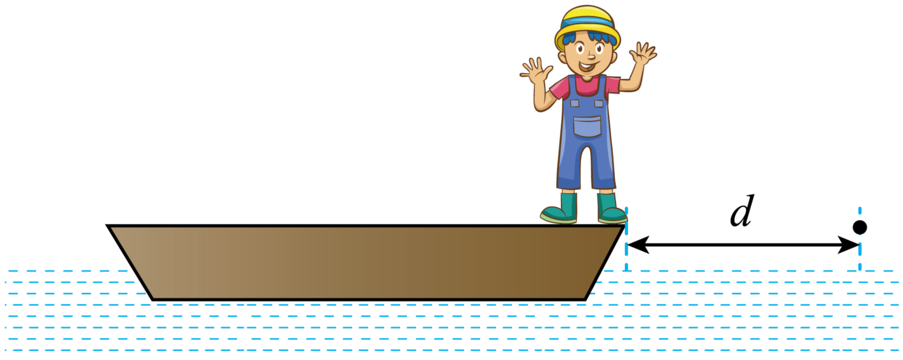

# Physics - 题目 266

**ID**: 9a24ebe5eabf465190d90690e1cba48d
**年级**: Grade 11
**难度**: Easy
**题型**: Multiple-choice

## 题目
如图所示，平静湖面上静止的小船的船头直立一垂钓者，距离船头右侧d处有一株荷花，当此人沿直线走到船尾时，船头恰好到达荷花处。​​​​​​​‌若已知人的质量为m，船长为L，不计水的阻力，则船的质量为（      ）

## 解答

1. 船和垂钓者组成的系统动量守恒，每时每刻均有 $mv{{}_{人}}=Mv{{}_{船}}$ ，所以有 $m{\overline{v}}{{}_{人}}=M{\overline{v}}{{}_{船}}$ ，两边同乘以t，有 $m{\overline{v}}{{}_{人}}t=M{\overline{v}}{{}_{船}}t$ ，即 $mx{{}_{人}}=Mx{{}_{船}}$ ，且有 $x{{}_{人}}+x{{}_{船}}=L$ ，其中 $x{{}_{船}}=d$ ，联立解得 $M=\frac {m\left ({L-d}\right )}{d}$ 。

## 知识点

**中文**:
  - 人船模型

**English**:
  - Man-Boat Model

---
