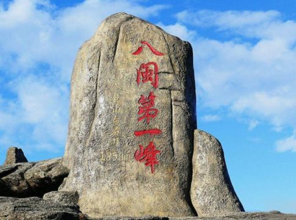

# Physics - 题目 2005

**ID**: a3b71b799bef4a578b48210674c78b95
**年级**: Grade 11
**难度**: Easy
**题型**: Multiple-choice

## 题目
如图所示，金铙山主峰白石顶海拔为1858m，素有“东南秀起第一巅”之称。​​​​​​​‌一质量为60kg的游客从海拔1200m处先乘缆车，后步行约3600m登上白石顶，共用时2小时。重力加速度g取10m/s^{2}，则该游客从乘缆车到登顶的过程中（      ）

## 解答

1. 根据题意无法确定游客的初末位置间的距离，所以位移不确定，而游客的竖直位移为658m，A错误；由于位移不确定，不能计算平均速度，B错误；克服重力所做的功为 $W=mgh=60\times 10\times 658{\rm{J}}=3.95\times 10{^{5}}{\rm{J}}{\rm ，C}$ 正确；克服重力所做功的平均功率约为 $P=\frac {W}{t}=\frac {3.95\times 10{^{5}}}{2\times 3600}{\rm{W}}=54.8{\rm{W}}{\rm ，D}$ 错误。

## 知识点

**中文**:
  - 功和功率
  - 功率的计算和估算

**English**:
  - Work and Power
  - Calculation and Estimation of Power

---
