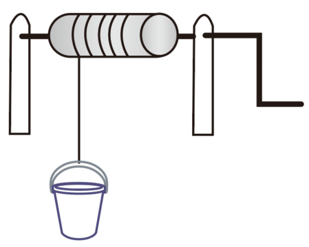

# Physics - 题目 1327

**ID**: b1ae2069fed94b16a8a79884bf052936
**年级**: Grade 11
**难度**: Easy
**题型**: Multiple-choice

## 题目
打水装置“辘轳”的简化图如图所示，转轴上的井绳一端通过四根等长的轻绳与水桶连接，其中每根轻绳与竖直方向的夹角均为θ，某次打水时水桶（包括水）的质量为m，不计井绳的质量及空气阻力，重力加速度为g。​​​​​​​‌若水桶加速上升时，井绳上的拉力大小为F，则此时每根轻绳的拉力大小为（      ）

## 解答

1. 根据对称性可知，四根轻绳的拉力大小相等，设为T，竖直方向根据 $4T{\cos}θ=F$ ，可得 $T=\frac {F}{4{\cos}θ}$ 。

## 知识点

**中文**:
  - 正交分解法与三角形定则在平衡问题中的应用

**English**:
  - Orthogonal Decomposition and Triangle Rule in Equilibrium

---
