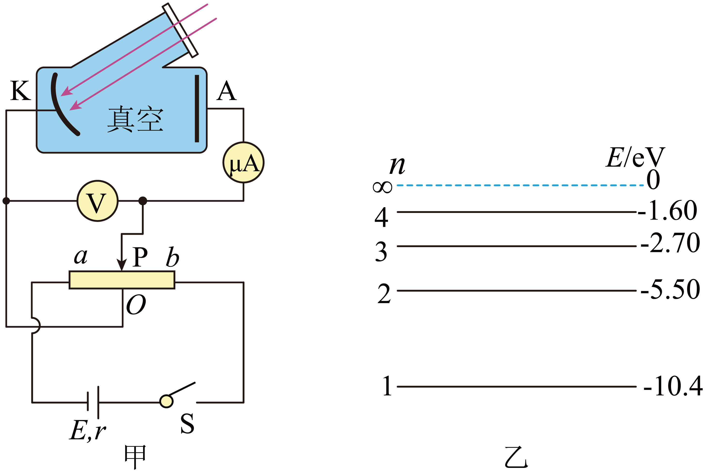

# Physics - 题目 563

**ID**: b6c0616a86ea47be9bac834939f21b29
**年级**: Grade 11
**难度**: Easy
**题型**: Multiple-choice

## 题目
图甲是研究光电效应的实验原理图，阴极由逸出功 $W{{}_{0}}=3.2{{0}}{\rm{e}}{\rm{V}}$ 的金属钙制成。​​​​​​​‌图乙是汞原子的能级图，用汞原子跃迁发出的光子照射阴极，下列说法正确的是（      ）

## 解答

1. A．大量 $n=4$ 能级的汞原子向低能级跃迁时只能发出 $C{{}_{4}^{2}}=6种{\rm ，}$ 频率的光，A错误；
2. B．由公式 $ε=E{{}_{n}}-E{{}_{m}}{\rm ，}$  $ε=hv{\rm ，}$  $c=λv{\rm ，}$ 可知光的能量越小，光的波长越长，结合能级图容易知道并不是从 $n=2$ 能级跃迁到基态发出的光子的能量最小，所以从 $n=2$ 能级跃迁到基态发出的光子波长不是最长的，B错误；
3. C．由 $ε=E{{}_{n}}-E{{}_{m}}{\rm ，}$ 可知从 $n=3$ 能级跃迁到 $n=2$ 能级发出的光子的能量为2.80eV，小于金属钙的逸出功，所以不能使金属钙发生光电效应，C错误；
4. D．大量 $n=2$ 能级跃迁发出的光子照射，当滑片P应向a端移动，有O点电势比a点的高，所以这时加在光电管的电压为反向电压，即K极加正极。所以有可能使得微安表示数为0，D正确。选D。

## 知识点

**中文**:
  - 产生光电效应的条件判断
  - 氢原子的能级结构、能级公式和跃迁问题

**English**:
  - Conditions for Photoelectric Effect
  - Hydrogen Energy Levels, Formulas, and Transitions

---
