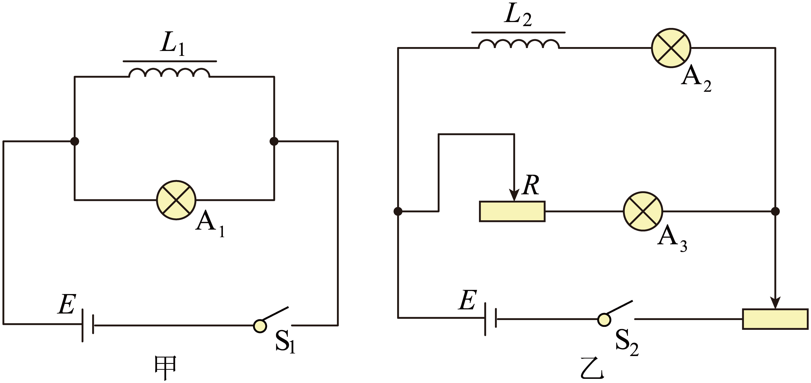

# Physics - 题目 2954

**ID**: ba6f64dc598146988e1db6cc1fea6188
**年级**: Grade 11
**难度**: Easy
**题型**: Multiple-choice

## 题目
图甲和图乙是演示自感现象的两个电路图，两电路中的灯和电源相同， ${\rm{L}}{{}_{{{1}}}}$ 和 ${\rm{L}}{{}_{{{2}}}}$ 为电感线圈。​​​​​​​‌实验时，断开开关 ${\rm{S}}{{}_{{{1}}}}$ 瞬间，灯 ${\rm{A}}{{}_{{{1}}}}$ 突然闪亮，随后逐渐变暗；闭合开关 ${\rm{S}}{{}_{{{2}}}}$ ，灯 ${\rm{A}}{{}_{2}}$ 逐渐变亮，而另一个相同的灯 ${\rm{A}}{{}_{3}}$ 立即变亮，最终 ${\rm{A}}{{}_{2}}$ 与 ${\rm{A}}{{}_{3}}$ 的亮度相同。下列说法正确的是（      ）

## 解答

1. 图甲中，断开开关 ${\rm{S}}{{}_{{{1}}}}$ 瞬间，灯 ${\rm{A}}{{}_{{{1}}}}$ 突然闪亮，是因为电流稳定时， ${\rm{L}}{{}_{{{1}}}}$ 的电流大于 ${\rm{A}}{{}_{{{1}}}}$ 的电流，可知 ${\rm{L}}{{}_{{{1}}}}$ 的电阻值小于 ${\rm{A}}{{}_{{{1}}}}$ 的电阻值，A错误；图甲中，因开始时通过 ${\rm{L}}{{}_{{{1}}}}$ 的电流向右，则断开 ${\rm{S}}{{}_{{{1}}}}$ 瞬间，灯 ${\rm{A}}{{}_{{{1}}}}$ 忽然闪亮，此时 ${\rm{A}}{{}_{{{1}}}}$ 中电流方向向左，B正确；图乙中，闭合开关 ${\rm{S}}{{}_{{{2}}}}$ ， ${\rm{L}}{{}_{{{2}}}}$ 对电流有阻碍作用，所以灯 ${\rm{A}}{{}_{2}}$ 逐渐变亮，而另一个相同的灯 ${\rm{A}}{{}_{3}}$ 立即变亮，最终 ${\rm{A}}{{}_{2}}$ 和 ${\rm{A}}{{}_{3}}$ 的亮度相同，说明变阻器R和 ${\rm{L}}{{}_{{{2}}}}$ 的电阻值相同，C错误；图乙中，闭合 ${\rm{S}}{{}_{{{2}}}}$ 瞬间，由于自感作用，通过 ${\rm{L}}{{}_{{{2}}}}$ 和灯 ${\rm{A}}{{}_{2}}$ 的电流 $I{{}_{2}}$ 会逐渐增大，而通过R和 ${\rm{A}}{{}_{3}}$ 的电流 $I{{}_{3}}$ 立即变大，因此电流不相等，D错误。

## 知识点

**中文**:
  - 自感现象的理解与分析

**English**:
  - Understanding and Analysis of Self-Induction

---
