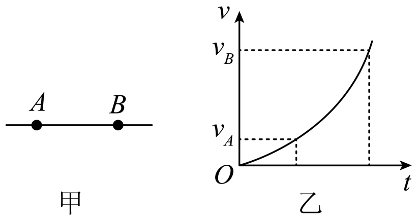

# Physics - 题目 738

**ID**: bbbcfbd2638749af92be2f7884d9f957
**年级**: Grade 11
**难度**: Easy
**题型**: Multiple-choice

## 题目
如图甲所示，A、B是一条电场线上的两点，若在某点释放一初速度为零的电子，电子仅受电场力作用，并沿电场线从A运动到B，其速度随时间变化的规律如图乙所示。​​​​​​​‌则（      ）

## 解答

1. 由图像可知，电子由A到B加速度变大，则电场力变大
2. F_{A}<F_{B}
3. 场强变大，即
4. E_{A}<E_{B}
5. 电子的动能变大，电势能减小，即
6. E_{PA}>E_{PB}
7. 电子则高电势点的电势能小，则电势
8. $φ{{}_{A}}<φ{{}_{B}}$
9. 故选C。

## 知识点

**中文**:
  - 电势能与静电力做功

**English**:
  - Electric Potential Energy and Work Done by Electrostatic Force

---
