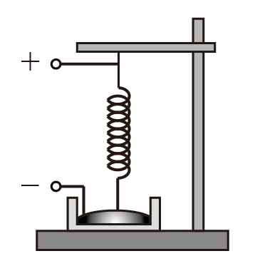

# Physics - 题目 985

**ID**: d2e937788ef243b6b4363bd91d06a77a
**年级**: Grade 11
**难度**: Easy
**题型**: Multiple-choice

## 题目
有人做了一个如图所示的实验：把一根柔软的弹簧悬挂起来，使它的下端刚好跟槽中的水银接触，接通直流电源，观察到的现象是（      ）​​​​​​​‌

## 解答

1. 初始，弹簧由于重力作用下垂与水银接触，接通直流电源，弹簧中有电流，相邻线圈有同向电流而相互吸引，弹簧向上收缩而导致其下端离开水银，弹簧中电流随之消失，弹簧由于重力又会向下伸长而使其下端再次与水银接触，以后重复这一过程，所以接通直流电源后，观察到的现象是弹簧开始不停地上下振动。

## 知识点

**中文**:
  - 阻尼振动的和受迫振动

**English**:
  - Damped and Forced Vibrations

---
