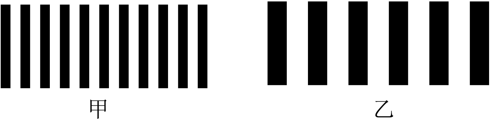

# Physics - 题目 860

**ID**: e1d9d2592e7a4744876e62552d4b6dbc
**年级**: Grade 11
**难度**: Easy
**题型**: Multiple-choice

## 题目
在光的双缝干涉实验中分别用两种颜色的单色光照射同一套装置，得到的干涉图样如图所示，则（      ）​​​​​​​‌

## 解答

1. AB．根据双缝干涉相邻两条纹间距公式 $Δx=\frac {L}{d}λ$ ，可知，用同一双缝干涉装置进行实验，条纹间距越大的波长越长，则乙光比甲光的波长长，乙光比甲光的频率低，A正确，B错误；
2. C．由于乙光比甲光的波长长，通过同一单缝，乙光衍射现象更明显，C错误；
3. D．不同频率的光在同种玻璃中的折射率不同，根据 $n=\frac {c}{v}$ ，可知波速不同，D错误。选A。

## 知识点

**中文**:
  - 干涉条纹和光的波长之间的关系

**English**:
  - Relationship between Interference Fringes and Wavelength

---
