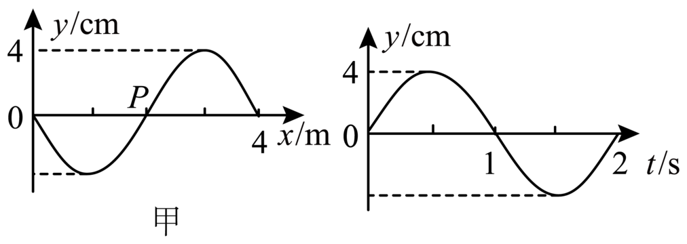

# Physics - 题目 2407

**ID**: e1e75a1a7a3c456ea9e1477db8acedcc
**年级**: Grade 11
**难度**: Easy
**题型**: Multiple-choice

## 题目
一列简谐横波在t=0时刻的波形图如图甲所示，P是介质中的一个质点，图乙是质点P的振动图像．下列说法正确的是​​​​​​​‌

## 解答

1. 由图乙可知，振幅A=4cm，周期T=2s，AC错误；由图甲可得：波长λ=4m，波速： $v=\frac {λ}{T}=\frac {4}{2}=2m/s$ ，B正确；由图乙可得：t=0s时，质点P向上振动，D错误；故选B．

## 知识点

**中文**:
  - 波的图像和振动图像的综合应用

**English**:
  - Integrated Application of Wave and Vibration Graphs

---
