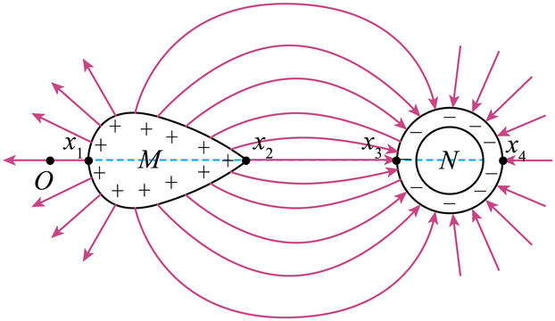

# Physics - 题目 1097

**ID**: ea64eee849d449a5b57a699b1da07541
**年级**: Grade 11
**难度**: Easy
**题型**: Multiple-choice

## 题目
在做静电实验时，出现了如图所示的情景，相距较近的两个带电金属导体M、N，其中导体N内部存在空腔，空间的电场线分布如图，取无穷远处电势为零，不计空气对电场分布的影响。​​​​​​​‌则其对称轴OMN上电势的变化规律可能正确的是（      ）

## 解答

1. $φ$ 取无穷远处电势为零，根据电场线的分布情况可知，正电物体的电势大于零，负电物体的电势小于零，导体内部电势相等。

## 知识点

**中文**:
  - 静电场中的图像问题

**English**:
  - Graph Problems in Electrostatic Fields

---
